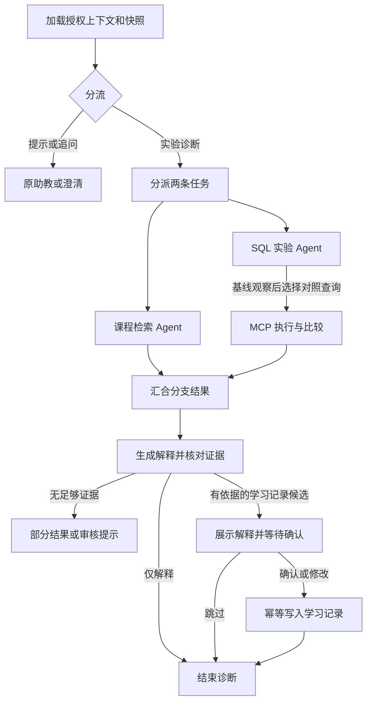

# QueryStep 多 Agent 扩展开发文档

| 项目 | 约定 |
|---|---|
| 文档状态 | 2026 年 11 月 13 日。第 1–12 节描述规格与计划目标，第 13 节记录实际实现、测试结果和复现命令。 |
| 首个交付场景 | 真实 EpiKT 推荐第 75 题后，用独立合成数据诊断 `GROUP BY` 和 `HAVING` 的错因。 |
| 第二个交付场景 | 对比 `LEFT JOIN` 条件放在 `ON` 和 `WHERE` 时未匹配行的变化，检验流程能否迁移。 |
| 开发入口 | 第 12 节。按阶段开发，以阶段放行条件作为交付定义。 |
| 相关文档 | [项目计划书](QueryStep｜EpiKT%20教学%20Agent%20项目计划书.md) · [本地启动与体验手册](QueryStep%20本地启动与体验手册.md) |

## 1. 目标与现有基线

学生做完一道 EpiKT 推荐的练习后，可以用自己的话说出判断，查看助教找到的课程依据和真实执行的示例结果，在同一页面改变实验参数，并在相关错题的后续辅导里用到自己确认过的学习记录。评审者能在同一个案例里核验选题对照、两个 Agent 各自的贡献、工具输入输出和恢复后的记忆。

现有正式模型使用 `artifacts/epikt-dbe-fold0/`，演示题库使用 `artifacts/dbe-sql-approved.json`。原有前后端和 `start.sh` 是本地演示入口。现有助教通过 `TutorAgent` 调用两个只读工具，按当前错题保存对话，并向模型提供最近两轮同题上下文。扩展版在错题页另设「运行诊断」入口，普通提问继续走现有 `/tutor`。开发期用显式开关 `QUERYSTEP_DIAGNOSTICS_ENABLED=1` 启用新功能，验收后再确定默认启用范围。 [推荐实现](../api/recommend.py) · [助教实现](../tutor/agent.py) · [会话与判分](../api/practice.py) · [一键启动](../start.sh)

### 1.1 参考医疗助手的设计映射

| 参考项目的实际行为 | 本项目的实现决策 | 可观察的验收证据 |
|---|---|---|
| `LeadAgent` 生成分派任务，`SwarmCoordinator` 在同一进程内并行运行 Worker，再汇总贡献。 | 用显式路由加结构化任务分派。固定两个专业 Worker，分别有自己的提示词、工具权限、迭代和输出 schema。汇总前核对两份独立贡献。 | 同一个 `run_id` 下有课程与实验两条分支轨迹，能够看到分支并行、部分失败和汇合。 |
| Skills 从本地文件发现，通过注册器生成工具 schema 并按调用 ID 回填工具结果。 | 使用显式工具注册和 Pydantic schema。由 MCP 客户端发现协议工具，再取项目允许的交集。 | 可用独立客户端发现同一工具。非法工具名或参数在执行前被拦截。 |
| BGE 和 Milvus Lite 返回知识片段，DeepResearch 可拆分查询并汇总来源。 | 使用版本化审核资料卡，按问题检索并返回引用。复杂跨主题问题可以改写查询，离线验证检索后再选择向量方案。 | 可追溯到卡片、版本和段落。发布检索样本、命中指标和误检样例。 |
| 进程内短期历史、Swarm 会话摘要及可选 Mem0 提供上下文。 | 延续当前对话表，增加按学习者隔离的学习记录和独立流程 checkpoint。错因由学生确认。 | 重启后恢复确认。记录可修改、删除，其他身份无法读取。 |
| 工具循环有预算和输出检查，部分工具权限问题仅告警。`MediX-R1` 另走 GPU 训练评估。 | 用执行前权限校验、预算和结果核验约束 Agent。EpiKT 继续走当前评分与评估链路。 | 拒绝工具调用时执行计数为零。固定历史的 EpiKT 选题与规则对照一致。 |

详细源码位置见原计划书 §4.3。 [医疗助手源码分析](../../examples/居丽叶简历项目7：医疗助手/medix-agent-swarm/PROJECT_ANALYSIS.md) · [医疗助手运行验证](../../examples/居丽叶简历项目7：医疗助手/medix-agent-swarm/RUN_GUIDE.md)

### 1.2 EpiKT 回归契约

1. 保留 `CalibratedScorer`、现有候选规则、三个冷启动题、75% 排序目标、55% 巩固下限、模型兼容性校验及规则回退。所有对照使用同一候选集合和历史版本。
2. 推理输入由服务端从已判分 `Attempt` 构造。原题 ID、KC 映射、模型及校准版本沿用当前契约。聊天、工具观察、学习记录、实验台尝试单独入库。
3. 同一正式权重和题库下，用新会话依次选择 `B、A、A` 得到错、错、对，第四题显示 EpiKT 选 75 号、规则选 69 号。选 A 可进入该题的错题反馈。每阶段重跑这条回归。
4. 新合成实验仅用于辅导。第二个 SQL 场景先用合成夹具验证诊断。只有已映射且有训练支持的正式题才进入 EpiKT 候选池。切换题库版本时沿用现有会话版本检查。

## 2. 用户流程与演示脚本

| 步骤 | 页面表现 | 系统动作与证据 |
|---|---|---|
| 1. 完成三道起步题 | 看到前三题由规则推荐，第四题显示「EpiKT 推荐」。 | 正式 checkpoint 评分，保存决策。选题记录显示 75 与 69。 |
| 2. 答错 75 号，打开诊断 | 输入「我看到三个课程，为什么不是三行？」并点「运行诊断」。 | 后端核验错题归属、是否为当前反馈、题库版本与启用的实验场景。建立带 `run_id` 的诊断。 |
| 3. 等待两项检查 | 页面分别显示「正在查课程说明」「正在运行分组示例」，分支完成后显示对应结果。 | 协调器并行分派。检索返回规则卡。SQL Agent 先跑分组计数，再根据观察检查哪些组满足阈值。 |
| 4. 查看实验与解释 | 并排显示查询、结果和被过滤的组。可以把 `> 1` 改为 `>= 1`，看结果变化。 | MCP 在原创合成表执行预审 SQL 模板。工具基于实际返回行计算差异，解释引用实验观察。公开展示的示例与当前题的题干、表数据及答案键分离。 |
| 5. 确认或修改记录 | 助教提出「复习分组后如何用 HAVING 筛选」。学生可确认、改写或跳过。 | 图在确认节点暂停。确认由服务端校验和幂等写入。页面可刷新或退出后在同一学习身份下恢复。 |
| 6. 继续练习及下次复习 | 下一题由原流程给出。下次遇到相关题时，助教可以说明用到了哪条已确认记录。 | EpiKT 仍从正式判分读取历史。辅导按身份和相关知识点召回有限记录，学习者可撤回。 |

### 2.1 可复现的实验数据

- **聚合夹具 `grouping_having@1`。** 使用虚构的包裹分类表，四个类别分别有 4、2、2、1 条记录。以 `category` 分组显示四行。`HAVING COUNT(*) > 1` 保留三组，`>= 1` 保留四组。使用另一份同结构数据，把两个计数为 2 的组都改为 1，验证 `> 1` 的解释随实际结果变为一组。记录实际行数、被筛选的类别和输入参数。数值用于独立示例。
- **连接夹具 `left_join_predicate@1`。** 合成账户与订单包含一个匹配行、一个无匹配行和一个仅匹配不合格订单的账户。对比右表条件在 `ON` 或 `WHERE` 时的结果。用账户 ID 作为稳定差异键，并显示右表空值。再用一个所有左表行均满足条件的变体检验「无差异」分支。
- 数据、模板、预期结果和中文知识说明由项目单独版本化。每次执行记录 `fixture_id`、版本、`query_id`、参数与结果指纹。表格排序按显式主键或分组键，比较用同版本、同数据的结果。

聚合模板建议注册为 `group_counts`、`having_gt`、`having_gte`。下例对应 `having_gt`。比较运算符由模板选择，`min_count` 由执行器绑定。

```sql
SELECT category, COUNT(*) AS parcel_count
FROM parcels
GROUP BY category
HAVING COUNT(*) > :min_count
ORDER BY category
```

| 夹具变体 | `group_counts` | `having_gt(min_count=1)` | `having_gte(min_count=1)` | 基线与 `having_gt` 比较 |
|---|---|---|---|---|
| A:4、B:2、C:2、D:1 | A、B、C、D | A、B、C | A、B、C、D | 移除 D |
| A:4、B:1、C:1、D:1 | A、B、C、D | A | A、B、C、D | 移除 B、C、D |

## 3. Agent 分工与 LangGraph

### 3.1 分派与结果契约

| 角色 | 输入与动作 | 输出与权限 |
|---|---|---|
| **教学协调器** | 输入当前错题的主题、允许的诊断场景、学生追问与已授权的上下文。输出路由 `hint`、`diagnosis` 或 `clarify`。用户主动开启并且命中已审核场景时，进入诊断。无法确定概念时先追问。 | 发两条类型化任务给 Worker，分别指定问题、允许工具和预算。汇总时读取已登记证据，输出 `DiagnosisResponse`。判分、选题和记忆写入由各服务处理。 |
| **课程检索 Agent** | 读取教学目标与问题，选择主题、SQL 关键字或查询改写，调用审核资料工具。 | `CourseResult(status, rule_summary, source_ids)`。只访问审核资料，可用结果为空时返回 `no_evidence`。 |
| **SQL 实验 Agent** | 工作流先经 MCP 取得基线查询。Agent 读取真实结果，根据提问选择获准的对照模板与参数。工作流通过 MCP 计算差异。 | 分支返回状态、观察和比较结果。工具按本次运行白名单使用夹具、模板和结果 ID。 |
| **证据校验节点** | 检查引用和观察都来自本次允许的结果，核对行数、差异键、结果方向和证据版本。 | 发布通过校验的解释或部分结果。声明「已验证」时附上实际工具证据。 |

结果包含 `summary`、`sources[]`、`observations[]`、`comparison` 和 `mode`。可核验结论通过比较对象及观察 ID 表达，例如 `before_row_count=4`、`after_row_count=3`、`removed_keys=["D"]`。系统从工具结果渲染数字和表格。Gemini 可从审核解释中选择一条并关联引用。校验失败时使用该主题的默认审核解释。角色权限、预算和校验在服务端执行。

### 3.2 图节点与状态



用 LangGraph `StateGraph` 实现分流和分支汇合。两个 Worker 写不同的状态字段，汇合节点等待两个分支都返回结果或明确的失败状态。首版保留 `tutor/provider.py` 的 OpenAI 兼容客户端。若用 LangChain 适配消息或工具，在现有 Gemini 网关上先通过真实的工具调用、`tool_call_id` 回填及结构化输出探针，再锁定可用版本。将模型与 MCP 客户端作为运行时依赖传入节点。 [LangGraph 工作流](https://docs.langchain.com/oss/python/langgraph/workflows-agents)

| 图状态字段 | 约定 |
|---|---|
| `run_id`、`decision_id`、`owner_ref` | 由后端生成或绑定。浏览器用会话 Cookie 鉴权，服务端校验所有权。模型消息中不传内部身份标识。 |
| `history_version`、`catalog_revision`、`workflow_version` | 启动时冻结。结果发布和确认前复验，过期运行进入 `stale`。恢复中的图使用兼容版本或明确结束并提示重开。 |
| `route`、`course_task`、`experiment_task` | 严格 schema。角色任务只包含该角色执行所需信息。 |
| `course_result`、`experiment_result`、`diagnosis` | 分支结果独立写入。证据结果按 ID 引用，按权限在服务端解析。 |
| `budget`、`branch_status`、`fallback_reason` | 记录总截止时间、分支结果、工具与模型调用次数。失败时能解释原因。 |
| `proposal_id`、`confirmation` | 记录提案和确认状态，写入以唯一键去重。 |

图状态只保存可序列化的业务状态和证据引用。连接对象、API 密钥、模型内部推理和未授权原题内容留在各自边界内。诊断完成后，原有 `POST /api/practice/next` 仍是继续练习入口。

### 3.3 ReAct、预算与回退

- **ReAct 的验收点。** 实验 Agent 把第一次 MCP 观察作为下一步输入。比如已有分组计数时才决定比较 `> 1` 与 `>= 1`。如果两个结果相同，走「解释为何相同」分支，避免宣称存在差异。测试改变夹具结果，检查后续动作或结论是否随之变化。展示查询、工具观察与步骤状态。 [ReAct 原论文](https://arxiv.org/abs/2210.03629)
- **执行预算。** 活跃诊断目标为 30 秒。当前两个分支各最多一次模型工具选择，有完整证据且剩余预算时可再发一次汇总请求。总计最多 3 次模型调用。课程最多 1 次 MCP 工具调用，实验最多 3 次，分别对应基线查询、模型选定的对照查询和确定性比较。工具调用使用剩余预算与单次上限中的较小值。普通 `/tutor` 沿用原预算。
- **双分支汇合。** 两边有有效证据时用结果模式 `full`。课程成功而实验失败时发布课程提示，标记 `partial` 并说明实验未完成。实验成功而课程失败时可发布结构化结果与已审核固定说明，同样标记 `partial`。两边都失败时回到 `reviewed_hint`。无有效证据时跳过错因提案。所有分支的超时和异常转成统一结果，允许汇合节点完成。
- **失效与取消。** 提交下一题、题库版本变化、服务端取消或期限耗尽后拒绝后续写入。检查运行版本与执行标记后再发布结论。状态及结果可用 `run_id` 查询。

## 4. MCP 服务与 SQL 执行边界

### 4.1 接入方案

首版用 MCP Python SDK，以 **stdio 子进程**运行服务。FastAPI 启动时预检 `initialize`、`tools/list` 和 schema。每次诊断或独立参数实验开启新连接与子进程，绑定夹具并在调用结束时关闭。查询执行经真实 `tools/call`。独立 MCP 客户端使用同一服务入口验证发现与执行。多实例部署确有跨进程网络需求时，再评估带身份校验的 Streamable HTTP。 [MCP 工具规范](https://modelcontextprotocol.io/specification/2025-11-25/server/tools) · [MCP 传输规范](https://modelcontextprotocol.io/specification/2025-11-25/basic/transports)

| MCP 工具 | 建议输入 | 结构化返回及限制 |
|---|---|---|
| `search_course_notes` | `query`、`topic`、`top_k` | 只搜已审核资料。`query` 长度上限 200，`top_k` 为 1–3，返回卡片 ID、版本、片段、标题、URL 和匹配信息。 |
| `describe_fixture` | `fixture_id` | 返回版本、SQL 方言、表结构、预审查询 ID 和参数 schema。夹具必须在本次允许范围。 |
| `run_example_query` | `fixture_id`、`query_id`、`parameters` | 绑定参数，返回 `observation_id`、结果列、有限样本行、真实行数、运行时间和结果指纹。未知键或模板直接拒绝。 |
| `compare_example_results` | `before_id`、`after_id` | 根据预定义差异键计算增加、删除和变更，返回两个观察的版本、计数与差异。只比较同一运行、同一夹具版本的观察。 |

运行作用域由服务端绑定到 MCP 调用，例如隔离的运行命名空间或由客户端注入的内部标识。模型提供的 `run_id`、`learner_id` 或权限字段没有授权效力。独立客户端只使用独立的测试命名空间。进程重启后复算预审结果或从应用证据表恢复上下文，旧 MCP 内存句柄需要重新生成。

### 4.2 执行策略和测试

- 首版只支持预审模板和参数化值。`HAVING` 的比较符用两个独立模板或枚举选择，数值参数做类型和区间校验。页面的「修改」先提供参数控件、查询预览和结果对照。
- SQL 工具子进程以最小环境运行，只持有合成夹具。连接设为只读语义，禁止加载扩展、附加数据库、DDL、写入和任意文件路径。模板参数通过参数绑定传递。首版目标为每条查询最多返回 50 行、单条执行预算 1 秒。使用 SQLite 授权回调和进度回调作为执行层约束，并用父进程时限覆盖阻塞。超限返回结构化错误，丢弃未完成结果。 [Python 3.11 `sqlite3` 官方文档](https://docs.python.org/3.11/library/sqlite3.html)
- 调用前检查工具名、角色白名单、JSON schema 和预算，执行端再验证参数和夹具范围。MCP 服务不可用时，诊断可降级到现有审核提示，练习与 EpiKT 继续可用。
- 独立进程中的自由 SQL 编辑器是后续功能。需要专门实现进程隔离、文件和网络权限约束、资源上限、方言与 SQL 白名单，并新增逃逸、注入、超时用例。

## 5. 课程检索与跨会话记忆

### 5.1 资料库与检索

将 §2 的两个场景各拆成概念卡、常见混淆卡和独立例题。资料卡字段用 `id/version/topic/title/section/url/text/review_status`。保留原主题检索作为基线。扩展版先做「题目主题过滤 + 学生提问和 SQL 关键词匹配」，允许相关主题作为扩展候选。向量检索实验用同一批卡片和人工标注查询，对比主题、关键词和语义检索的 Recall@3、引用正确率和延迟。语料先覆盖 `GROUP BY`、`HAVING`、`LEFT JOIN`、`NULL`、`ON` 和 `WHERE`。受控资料以项目原创说明和已审核的官方文档为主。 [PostgreSQL 聚合教程](https://www.postgresql.org/docs/18/tutorial-agg.html) · [PostgreSQL 表表达式](https://www.postgresql.org/docs/18/queries-table-expressions.html)

### 5.2 四类状态及读写权

| 状态 | 存储和用途 | 写入者与读取范围 |
|---|---|---|
| **正式学习历史** | 现有 `Attempt`，保留已判分事件、序号和题目映射。 | 仅判分服务写入，EpiKT 读取当前学习者的合格事件。 |
| **同题短期上下文** | 现有 `TutorTurn`，保存按题问答，辅导模型读取最近两轮。 | 助教服务写入，刷新按会话归属恢复。 |
| **可恢复的执行状态** | LangGraph 持久 checkpoint。`thread_id` 与服务端 `run_id` 绑定。 | 图运行器写入，恢复前从业务表验证身份和版本。 |
| **跨会话学习记录** | 新 `learning_memories`，保存已确认的错因或复习点及来源。 | 由确认端点写入，助教按学习者与相关主题读取。学生可修改和删除。 |

`learning_memories` 建议字段包括 `memory_id`、`learner_id`、`proposal_id`、`topic`、可选 `source_kcs`、`summary`、`decision_id`、`evidence_refs`、`status`、`created_at`、`updated_at` 和 `deleted_at`。`(learner_id, proposal_id)` 唯一。修改采用版本号或等效的乐观锁。删除后立即排除召回。日志和实验报告只引用样本 ID 和允许公开的合成证据。

**召回与上下文组装。** 首版按学习者隔离，按同主题或相关 KC、确认状态、更新时间筛选，最多取两条。传给 Gemini 的字段以简短的已确认总结和相关知识点为主。浏览器关闭、服务器重启后可用原学习会话继续。跨浏览器共享学习记录需要统一的学习者认证，单独规划。模型猜测停留在诊断提案，学生跳过即可结束本次流程。

**暂停、恢复与确认。** `interrupt()` 节点只读提案并等待学生选择，后续独立节点负责写入。确认端点验证所有权、提案状态及历史和题库版本，使用 `Command(resume=...)` 恢复。由于暂停节点可能重放，确认动作以唯一键幂等提交。若学习者已离开该错题或题库修订，旧提案显示为过期。已确认记录可以用于以后相关题的辅导。 [LangGraph 持久化](https://docs.langchain.com/oss/python/langgraph/persistence) · [暂停与恢复](https://docs.langchain.com/oss/python/langgraph/interrupts)

## 6. API、运行状态与前端

### 6.1 新增 API 契约

以下路径和字段是开发规格。沿用 FastAPI、Pydantic、现有会话 Cookie 和 `Cache-Control: no-store`。读取或变更任何运行、证据与记忆均先核对会话身份及记录归属。

| 方法与路径 | 请求与结果 | 验收要点 |
|---|---|---|
| `GET /api/practice/{decision_id}/diagnosis` | 恢复该错题最近一次可访问的运行，返回 `available`、主题和运行快照。当前没有运行时返回 `run: null`。 | 刷新后能恢复。其他身份查询返回 404。 |
| `POST /api/practice/{decision_id}/diagnosis` | `message`、`idempotency_key`。受理返回 `202` 和 `run_id/status`。同键同请求返回已有运行；同键异载荷返回 `409`。 | 只允许当前已判分错题。正常练习操作不触发诊断。模型输入不含幂等键。 |
| `GET /api/diagnosis/{run_id}` | 返回 `status`、分支状态、已校验结果、可用的 `proposal` 和已登记待恢复的确认选择。进度序号由事件接口提供。 | 终态可重读。旧题结果可回看，过期提案无法再确认。 |
| `GET /api/diagnosis/{run_id}/events` | 可选 SSE，读取 `Last-Event-ID` 或 `after_seq`，输出按序的公开事件。客户端也可轮询状态。 | 网络恢复后可查询最终状态。未校验模型内容不进入公开流。 |
| `POST /api/diagnosis/{run_id}/experiment` | `query_id`、合法参数、`idempotency_key`，返回只读观察。展示结果可与同一夹具的原观察对比。 | 当前错题有效且模板获准。结果不进入 `Attempt`，也不会直接写入学习记录。 |
| `POST /api/diagnosis/{run_id}/confirmation` | `proposal_id`、`action=confirm/edit/skip`、可选 `summary`、`idempotency_key`。返回确认状态和已保存记录 ID。 | 同一提案与相同选择复用原结果，刷新后也可恢复。不同选择或过期提案返回 `409`。 |
| `POST /api/diagnosis/{run_id}/cancel` | 请求取消并返回当前状态。已结束的运行返回已有终态。 | 取消后，迟到的工具和模型结果无法发布。 |
| `GET /api/learning-memories` | 返回当前学习者的有效记录，支持按主题筛选和分页。 | 只查询已确认且未删除的记录。 |
| `PATCH /api/learning-memories/{memory_id}`、`DELETE /api/learning-memories/{memory_id}` | 修改时提交新摘要与预期版本。删除按学习者权限执行并立即停止召回。 | 防止跨身份写入及并发覆盖。重复删除可幂等成功。 |

首版可先用 `202 + 轮询` 验证全过程。SSE 在阶段 4 补上，事件从实际节点或工具状态产生。事件类型限定为 `run_started`、`branch_started`、`branch_finished`、`evidence_verified`、`waiting_for_confirmation`、`run_finished`，每条带 `run_id`、`seq`、公开状态和时间。写入状态和对应事件使用同一事务。流式传输可断线，业务状态由状态接口恢复。学生看到的数字和 SQL 结果在后端验证后发布。 [LangGraph 事件流](https://docs.langchain.com/oss/python/langgraph/streaming)

### 6.2 状态机与一致性

使用 `queued → running → waiting_confirmation → completed`。无需提案时从 `running` 进入 `completed`。部分证据或审核提示作为 `result.mode=partial/reviewed_hint` 写入 `completed`。执行失败且无法生成结果时为 `failed`。`cancelled` 与 `stale` 是独立终态。

- 运行开始时校验已有 `decision_id`、`Attempt`、当前 `history_version` 和 `catalog_revision`。同一错题最多一个活动诊断。用数据库约束与事务保护这一条件，应用内锁用于减少争抢。
- 每次模型或 MCP 调用放在事务之外。发布前对运行状态、执行租约和历史版本做原子检查。现有 `Practice` 对迟到辅导的拦截和幂等判分可用作实现参考。 [现有事务边界](../api/practice.py#L179)
- 首版本地用单执行器从数据库领取 `queued`，对 `running` 持有有期限的租约和递增执行令牌。进程退出时，`waiting_confirmation` 可从持久 checkpoint 恢复。中断的 `running` 可在租约过期后回收为可重试失败，重新启动一次诊断。只读查询若被重跑，凭证据唯一键去重。只有持有最新令牌的执行者可以更新运行状态。
- 使用 `proposal_id` 和确认幂等键记录首次动作及结果。确认与图恢复若分两步，先登记待处理确认，再由运行器恢复，按唯一键写入记忆并标记完成。遇到数据库已写成功但图状态尚未更新的情况，重放时直接取已有记录。覆盖确认竞速、重复提交、失效提案和客户端重连。
- 截止时间只覆盖主动执行阶段。等待确认时释放模型、MCP 和执行器资源，按独立的提案有效期管理。首版建议以错题仍是当前状态作为主要有效条件，记录创建时间，并由过期清理任务回收超过 24 小时的未确认提案。

### 6.3 页面组件

在当前错题反馈区加入「运行诊断」和状态卡。默认展示简短解释、可展开的课程引用、并排结果与参数控件。用可读名称显示被筛除的分组或行，表格有标题及空结果提示。诊断进度基于实际事件。请求失败时保持已有反馈和可重试入口。继续下一题时释放页面订阅，并让后端把未确认诊断标记为过期。

学习记录区展示摘要、关联主题、来源和更新时间，提供确认、编辑、跳过和删除。再次召回时可以显示「参考了你此前确认的学习记录」及对应摘要。技术轨迹放在可折叠的详情中，显示分工、工具名、证据和耗时。网页保留现有练习进度、选题对照和 Gemini 等待提示。

## 7. 存储、迁移、配置与部署

| 表或存储 | 建议字段及约束 |
|---|---|
| `diagnosis_runs` | `id`、`learner_id`、`decision_id`、`history_version`、`catalog_revision`、`request_key`、`request_hash`、`status`、`mode`、`workflow_version`、`model_version`、`lease_until`、`execution_token`、`result`、`created_at`、`updated_at`。学生范围内的请求键唯一，索引支持按错题恢复及领取任务。 |
| `diagnosis_events` | `run_id`、`seq`、`node`、`event_type`、`payload`、`created_at`。`(run_id, seq)` 唯一。日志不写 API 密钥或未脱敏的模型输入。 |
| 运行中的证据和提案 | `diagnosis_runs.result` 保存本轮已校验的课程卡片、观察和比较。`proposal` 与 `confirmation` 同行存储，继承运行的所有权和事务边界。证据 ID 在所属结果内解析。 |
| `diagnosis_experiments` | 按 `(run_id, request_key)` 保存参数实验的请求指纹和结果，便于重复请求返回同一组观察。 |
| `learning_memories` | 使用 §5.2 的归属和唯一键。修改递增 `version`，删除设置 `deleted_at` 并停止召回。 |
| LangGraph checkpoint 存储 | 用受支持的 SQLite checkpointer 支持本机，部署需要多实例时使用 PostgreSQL checkpointer。业务数据库保存访问控制、状态和终态，checkpoint 管执行恢复。保留可用的迁移与清理入口。 |

先建立现有 schema 的迁移基线，再引入扩展表。当前仓库通过 `Base.metadata.create_all()` 建初始表，生产结构变更采用版本化迁移。开发先用现有数据库副本和空库分别做升级测试，确认旧会话、作答、选题和助教记录都能读取。SQLite 与 PostgreSQL 的约束、事务竞速和排序分别验证。 [当前数据库定义](../api/db.py)

诊断相关依赖单列可选依赖组并锁定兼容版本。新增开关默认关闭，应用启动先自检协议与数据库，再单独报告诊断状态，例如 `diagnostics_ready`、`mcp_ready` 和 `diagnostics_reason`。保留 `epikt_ready` 和 `tutor_ready` 的原语义。MCP 进程随应用生命周期管理，只接收必要环境变量。Gemini 继续沿用 `.env` 的模型配置。本机保持一键启动，部署阶段再扩展 Compose。降级或回滚时关闭诊断开关，练习与已保存数据继续可用。

## 8. 评估与验收样本

### 8.1 对照方案

| 对照 | 固定条件 | 变化项 | 要回答的问题 |
|---|---|---|---|
| EpiKT vs. 普通规则 | 历史、候选池、课程约束和辅导方式 | 选题评分器 | 正式模型是否仍实际影响下一题，原回放是否一致？ |
| 现有助教 vs. 单 Agent + MCP | 同一问题、课程材料版本、模型配置。记录每组允许的工具。 | 是否有 SQL 实验工具与结构化观察 | 执行工具是否改善诊断和证据一致性？ |
| 单 Agent + MCP vs. 双 Worker 协作 | 同一模型、同一输入、同一资料和 SQL 工具、同一总时间与调用预算 | 单 Agent 或课程检索／实验分工 | 同样有工具时，多角色是否对复杂问题有收益？ |
| 记忆开启 vs. 关闭 | 相同后续题、同一模型、同样的历史问答和检索资料 | 是否提供之前确认的相关学习记录 | 后续辅导是否更贴合且没有误用无关记录？ |
| 主题 vs. 关键词 vs. 向量 | 固定语料与人工标注，控制返回数量 | 检索方法 | 开放式追问是否更容易命中相关卡片？ |

使用与开发样例分开的固定验收集。首轮计划至少 24 个辅导案例，分别覆盖聚合、连接、简单问题和异常或对抗输入。为复杂题标注 SQL 结果、因果解释要点、可接受工具序列和允许的替代轨迹。记忆另设至少 8 组前后会话，包含相关、无关、已删除和他人记录。对真人教学效果的判断沿用原计划书的独立实验设计。

### 8.2 指标及放行线

| 指标 | 计算或检查方法 | 首轮计划目标 |
|---|---|---|
| EpiKT 选题回归 | 正式权重与固定历史逐项核对推荐来源、题号和规则对照。 | 固定案例为 `75/69`，三个冷启动题一致。 |
| 查询与证据准确性 | 用独立 SQL 预期结果比较 MCP 输出，核对事实声明的行数、结果方向和被过滤键。 | 固定夹具和边界用例全部一致。发布的可核验结构化断言全部能在工具观察中查到。 |
| 诊断正确率与引用 | 人工按预先写好的解释要点盲审，程序核对引用 ID、版本和可访问性。 | 报告分子和分母、错例及各组差异。双角色只在复杂题更有帮助且达到延迟目标时作为默认路由。 |
| 回退和安全性 | 注入非法调用、错误引用、空结果、单分支故障、模型超时和 MCP 退出。 | 固定用例全过，非法工具调用执行次数为零，练习接口持续可用。 |
| 执行时延与成本 | 记录每次模型和工具调用次数、耗时、可用的 token 计数，报告端到端 P50/P95 和超时比例。 | 主动诊断总预算 30 秒。任何超时都有明确终态或部分结果。先测现有 Gemini 网关再锁定 P95 目标。 |
| 恢复与记忆隔离 | 测试页面刷新、进程重启、并发确认、他人身份、记忆修改和删除。 | 重启后能恢复等待确认。同一提案最多写入一条记录。跨身份读取和删除后召回的测试均通过。 |

测试使用两类运行。固定的协议响应覆盖状态、分支、故障和安全边界，真实 MCP 检查协议、实际查询结果和子进程生命周期。真实 Gemini 仅用批准的合成提问验收端到端，并单独记明已运行与未运行的项。评估输出记录模型、提示词、图、题库、夹具和检索语料的版本，分别保存工具证据、最终诊断和人工审查结果。

## 9. 开发阶段、交付与验收

工期是单人开发的首轮估计，范围包含代码、测试和演示。模型服务联调、资料审阅和外部试验招募按实际情况另计。

| 阶段 | 工作量与任务 | 完成条件与交付 |
|---|---|---|
| **0 · 固定基线** | 1–2 人日。记录 Git、现有工作区改动、模型与题库指纹、依赖版本。读取现有 `api/`、`tutor/`、`kt/`、`course_content/`、测试和启动脚本。 | 当前测试与构建结果、正式模型预检、`75/69` 回放、Gemini 已有验收及新环境探针结果。 |
| **1 · 可验证的实验工具** | 3–5 人日。加版本化聚合夹具和预审模板、确定性执行与结果差异、MCP server/client、白名单和时限。 | 实际 stdio 完成发现和工具调用；独立客户端复现 `4 → 3`、`>= 1` 返回 4，以及变体 `> 1` 返回 1。拒绝未知模板、越界参数和跨运行观察 ID。原 EpiKT 回放通过。 |
| **2 · 多 Agent 诊断** | 5–8 人日。实现 LangGraph、两分支、受限 ReAct、执行预算、证据校验、诊断 API 与前端。 | 浏览器走完 75 号错题的真实 Gemini 和 MCP 诊断。验证资料与实验分支都贡献证据，夹具变化能改变后续动作或解释，单分支失败可见。原助教与练习回归通过。 |
| **3 · 可恢复的跨会话记忆** | 4–6 人日。增加迁移、持久 checkpoint、提案确认与编辑、记忆召回和隔离。 | 刷新、后端重启和重复确认通过。用同一学习身份在相关错题看到记忆生效；对照无关、删除与其他学习者的记录。 |
| **4 · 第二场景、对照和交付** | 4–7 人日。增加 `LEFT JOIN` 夹具、SSE、结构化轨迹和评估脚本，整理操作手册和演示记录。 | 跑完三组助教对照及记忆消融。交付评估摘要、失败样例、可复现命令和演示步骤。按实测设置默认路由。 |

主体合计约 **17–28 人日**。优先打通一个端到端案例，再扩到第二种 SQL 错因。每阶段保留已通过的启动与复现命令，并记录变化的接口和数据版本。

## 10. 建议目录与关键测试

```text
QueryStep/
  api/                         现有鉴权、判分与推荐，新增诊断及记忆入口
  kt/                          现有模型加载、校准与评分
  tutor/
    agent.py                   现有轻量助教
    diagnosis/                 新增图、角色、证据校验和运行生命周期
  course_content/
    lessons.py                 现有按主题资料
    diagnosis_cards/           新增版本化概念、错因和例题卡
    sql_fixtures/               新增原创合成数据及预审模板
  sql_lab/                     新增执行器、MCP 服务与协议客户端
  migrations/                  版本化迁移与升级、回滚说明
  evals/                       保留选题回放，新增诊断与记忆对照
  tests/                       协议、状态、SQL、权限、回归和浏览器验收
  web/src/                     诊断状态、实验结果、学习记录与证据展示
```

先按现有目录增加最小模块。职责简单时可合并文件。Agent 角色的差异以独立工具权限和输出契约体现，避免为每个节点额外引入服务。

| 必测用例 | 可重复验收方式 |
|---|---|
| 正式选题与数据隔离 | 固定首答后分别运行、修改 SQL 实验和确认记忆，对比前后的 `Attempt` 数量和 `history_version`。仅正式提交增加历史。 |
| SQL 证据驱动 | 以相同问题替换夹具计数，核对实际结果、验证后的解释和执行轨迹。增加等价查询和空结果样本。 |
| 工具权限 | 对课程 Agent 请求执行 SQL，对实验 Agent 请求未授权夹具，检查在真实调用前被拒绝。注入错误 JSON、未知参数及伪造的来源 ID。 |
| 运行并发 | 并发启动同键请求，收到同一个 `run_id`。中途继续下一题或取消，迟到结果无法写入。 |
| 恢复与记忆 | 暂停后重启服务，再确认并重复提交。验证只写一次，且新一轮辅导用到了相关摘要。 |
| 引用与泄漏 | 工具返回内容带伪指令时，模型权限保持由服务端限定。独立例子与当前题分开，拒绝将原题答案、密钥或其他学习者资料写进公开轨迹。 |
| 旧版可用性 | 关闭扩展开关，复测现有三项功能及 `start.sh`。升级数据库副本后确认原会话记录可以恢复。 |

## 11. 后续选型与范围

- **向量检索。** 先用人工标注的跨主题问题做检索对照。需要提升召回时，再选本地多语向量模型与索引。医疗助手的 BGE 与 Milvus Lite 是参考组合，QueryStep 依据语料规模、中文与 SQL 标识符覆盖及实际时延决定部署方式。
- **A2A。** 有独立课程审核服务时引入。课程维护者提交待审题，审核 Agent 运行参考 SQL 和边界用例，返回答案唯一性和提示检查报告。实现 Agent Card、任务提交、状态查询和结果交付，发布由维护者确认。 [A2A 规范](https://a2a-protocol.org/latest/specification/)
- **自由编写 SQL 和正式判分。** 在安全隔离和多数据集判分机制就绪后独立设计。新题型进入 EpiKT 评分前需要对应映射和同口径训练支持。
- **可观测性。** 先落本地结构化运行记录与阶段时延。需要跨服务追踪时用 OpenTelemetry 关联 `run_id`、模型请求和工具调用 span。 [OpenTelemetry 的 Agent 追踪示例](https://opentelemetry.io/blog/2026/genai-observability/)

## 12. 给后续开发者的实施指令

将本节与目标阶段的详细规格一起交给开发者或编码 Agent。当前文档定义目标与验收，开始代码工作时以工作区源码和实际运行结果核实基线。

1. **定位并保护已有工作。** 在 QueryStep 根目录查看工作区状态和适用的项目指令。阅读原计划书、现有助教和推荐链路、数据库、题库、模型预检与测试。保留已有未提交改动。用正式 run 复现 `75/69`，记录当前测试结果及版本。
2. **按本次要求的阶段交付。** 默认从第一个尚未验收的阶段开始。先列出需要修改的文件、接口、数据迁移、失败路径和验收命令，再把该阶段贯穿到真实入口。用合成数据和协议替身建立稳定回归，用真实 MCP 或真实 Gemini 验证对应集成。继续沿用原来的作答与推荐入口。
3. **落实工具与模型边界。** 从已鉴权的错题生成允许的场景与证据范围。工具输入和输出双向校验，执行预算覆盖内部重试。任何数值结论先核对实际工具输出。把跨会话记忆写入集中在独立的确认节点，记录幂等键和状态版本。
4. **完成可复现验证。** 至少运行现有后端测试、前端构建、正式题库预检和该阶段新增验收。测试使用隔离数据库，SQL 实验使用合成夹具。对有 SQLite／PostgreSQL 差异的改动分别覆盖。实测记录写清命令、条件、样本数和结果。需要运行实际学生路径时，用独立浏览器会话。
5. **按交付物报告完成情况。** 列出改动与可体验入口、实际运行的测试和未验收项、模型及数据版本、回退方式、复现步骤。用记录证明 EpiKT 仍决定下一题、MCP 执行真实查询、图能处理部分失败及恢复、记忆按学习者隔离。学习收益以单独实验实测值表述。

阶段 0 建议运行的现有命令如下。所有命令从项目根目录执行。

```bash
conda activate querystep
git status --short --branch
python -m unittest discover -s tests
npm --prefix web run build
python -m course_content.check_catalog \
  --run artifacts/epikt-dbe-fold0 \
  --catalog artifacts/dbe-sql-approved.json
```

需要回放整个留出集合时，使用现有 `evals.replay_policy`。它会在指定 run 目录写评估报告。基线留档优先复制一份完整的正式 run 到本地评估目录再执行。

```bash
test ! -e artifacts/epikt-dbe-fold0-baseline && \
  cp -R artifacts/epikt-dbe-fold0 artifacts/epikt-dbe-fold0-baseline
python -m evals.replay_policy \
  --run artifacts/epikt-dbe-fold0-baseline \
  --catalog artifacts/dbe-sql-approved.json
```

从阶段 1 起，应为新增 MCP 入口、诊断端到端验收和评估脚本提供实际可运行命令，并纳入操作手册。新增诊断数据结构和提示词可随实测调整，调整后更新本规格与对应测试。

## 13. 实施记录与复现

### 13.1 已交付的代码

| 阶段 | 实际实现与证据 |
|---|---|
| 0 · 正式基线 | 开工时 Git 为 `47d8643`。基线 32 项测试和前端构建通过。正式 checkpoint `epikt-dbe-fold0` 的模型标识为 `c31ae1ebdda8`，题库指纹为 `253f2700634e6b03e275036db25854a3377a0fbb4e66cd7a80562249450e50ce`，24 题均通过映射预检。新会话 B、A、A 后，EpiKT 选 75，普通规则选 69。用权重副本回放 108 位留出学习者的 1,957 个有效前缀，新旧 `policy_replay.json` 逐字节一致。 |
| 1 · MCP 和实验 | 实际 stdio 完成协议发现、schema 校验和 `tools/call`。聚合标准 `4 → 3`、`>= 1` 保留 4 组、变体 `> 1` 保留 1 组。连接标准 `3 → 1`、全匹配变体结果键相同。服务端拒绝跨运行观察 ID、任意 SQL、未知模板和越界参数。 [独立探针](../sql_lab/check.py) · [SQL 运行器](../sql_lab/executor.py) |
| 2 · 多 Agent 错题诊断 | 课程和实验分支并行，各自选择检索词或 SQL 对照动作。实验动作读取实际基线。汇总消费经校验的结果，输出 `full`、`partial` 或 `reviewed_hint`。真实浏览器完成一次 Gemini 双分支诊断和 `4 → 3` 对照，另一次复测的实验 Agent 超时并返回部分结果。 [诊断图](../tutor/diagnosis.py) · [页面](../web/src/DiagnosisPanel.tsx) |
| 3 · 跨会话记忆 | 独立确认图使用 SQLite checkpoint。学生确认选择持久登记后恢复图，再按提案唯一键写入。覆盖后端重启、恢复中断的确认、重复提交、编辑版本冲突、软删除和跨身份隔离。召回按同一学习者和同一主题，最多两条。真实浏览器在 75 号题保存记录，下一道相关聚合题的 Gemini 辅导在一次超时及重试后成功读取该记录。保持同一会话 Cookie 可跨访问恢复，点击「重新开始」会生成新学习身份。 [确认图](../api/learning_memory.py) · [迁移记录](../migrations/README.md) |
| 4 · 连接场景与对照 | 正式 EpiKT 回归复现推荐 81 号题，同前缀规则对照为 70 号。提交该错题后走 `LEFT JOIN` 诊断入口，两个合成夹具的结果均经 MCP 验证。SSE 事件与业务状态一同入库，轮询支持恢复。三组真实模型评估和记忆消融见 §13.3。 [评估脚本](../evals/diagnosis.py) · [测试](../tests/test_diagnostics.py) |

本机验收使用 Python 3.11、`mcp==1.30.0`、`langgraph==1.2.21` 与 `langgraph-checkpoint-sqlite==3.1.3`。45 项后端测试与前端构建通过。业务库事务及重复请求覆盖 SQLite 和本机 PostgreSQL 16.14 单实例，后者单独执行的诊断测试通过 6 项。当前诊断由一个应用执行器领取任务，确认 checkpoint 使用本机文件。独立的 PostgreSQL checkpoint、生产多副本和跨浏览器账户绑定仍待单独验收。服务升级沿用 `diagnostics_001` 和 `diagnostics_002` 增量迁移。

### 13.2 本地复现

从 QueryStep 根目录执行。现有 `.env` 提供 Gemini，正式权重和已审核题库位于 `artifacts/`。

```bash
conda activate querystep
python -m pip install -e '.[api,kt,diagnostics,test]'
npm --prefix web ci
QUERYSTEP_DIAGNOSTICS_ENABLED=1 ./start.sh
```

使用已存在的独立诊断环境时，启动命令如下。

```bash
QUERYSTEP_DIAGNOSTICS_ENABLED=1 QUERYSTEP_PYTHON="$PWD/artifacts/diagnostics-venv/bin/python" ./start.sh
```

打开 [本机练习](http://127.0.0.1:5173/)，按当前体验手册走完学生流程。关闭前后端用终端的 `Ctrl+C`。演示步骤及超时后的可用操作见 [体验手册第 3 节](QueryStep%20本地启动与体验手册.md#3-从错题到下一题)。

```bash
python -m pytest -q
npm --prefix web run build
python -m course_content.check_catalog --run artifacts/epikt-dbe-fold0 --catalog artifacts/dbe-sql-approved.json
python -m sql_lab.check
python -m sql_lab.check --fixture left_join_predicate@1
```

复用本机已安装的 Playwright 和 Chromium 时，另开终端执行浏览器脚本。它会创建独立浏览器会话，使用本机配置的真实模型，提交前四道演示题并验证后续辅导。需要隔离数据时，启动前给 `QUERYSTEP_DATABASE_URL` 指定单独的 SQLite 文件。设 `QUERYSTEP_TEST_ALLOW_PARTIAL=1` 时，网关超时可走部分证据和参数实验验收，脚本会报告实际执行的路径。

```bash
NODE_PATH="$PWD/artifacts/browser-tools/node_modules" \
PLAYWRIGHT_BROWSERS_PATH="$PWD/artifacts/browser-tools/browsers" \
node tests/browser_diagnosis.cjs
```

使用空白 PostgreSQL 测试库复现业务层验收。测试会创建表和合成记录，`QUERYSTEP_TEST_DATABASE_URL` 应指向专用测试数据库。测试 checkpoint 在独立的临时文件中。

```bash
QUERYSTEP_TEST_DATABASE_URL='postgresql+psycopg://querystep@127.0.0.1/diagnosis_test' \
python -m pytest -q tests/test_diagnostics.py
```

### 13.3 三组对照与记忆消融

| 方案 | 实际评估实现 |
|---|---|
| 原助教 | 使用原 `TutorAgent`、原课程资料工具和同一模型，以固定合成问题作为输入。它可以解释概念，缺少 SQL 实验与可核验的行差异。 |
| 串行单 Agent | 同一 SQL 助教依次完成课程检索、读取检索证据、选择实验并汇总。工具权限、夹具、模型和调用上限与双分支相同。 |
| 并行双 Agent | 两个角色分别检索课程依据、根据基线选择 SQL，再汇总。实验分支在工具选择阶段独立于课程分支。 |

自动评分同时核对目标模板、参数、差异键、行数以及引用 ID 与版本。原助教没有结构化 SQL 证据，其「可核验结果」为零是能力口径造成的，概念解释仍可按盲审规则评分。比较两组 MCP 流程时，也记录串行提前获得课程材料这一上下文差异。当前对照比较的是完整执行方案的表现。固定题集中包括合成对抗输入。

真实评估只发送合成问题、预审资料及合成 SQL 结果。报告收集请求次数、实际返回的 token 计数、耗时与回退。`--from-report` 可复用已有观测并离线重算指标。并发数会影响网关负载，比较报告时需同时注明。费用仍需以网关账单为准。

```bash
set -a
source ./.env
set +a
python -m evals.diagnosis --concurrency 3 --output artifacts/diagnosis-new-run.json
python -m evals.diagnosis --from-report artifacts/diagnosis-new-run.json --output artifacts/diagnosis-rescored.json
```

**四题先导实验。** 原助教、串行、并行的可核验结果分别为 `0/4`、`2/4`、`3/4`。中位耗时分别为 22.74、26.66、21.26 秒。网关超时导致部分案例缺失证据，报告保存在 `artifacts/diagnosis-pilot.json`。这里的先导统计以差异键为主要指标，完整报告另外核对请求的 SQL 模板与参数。

**24 题实际对照。** 以 `gemini-4-argon-high` 运行 72 次策略评估，并发 3 个案例。三组共同使用每个案例的合成提问。表中延迟包含网关等待，token 小计只覆盖返回 `usage` 的请求。原助教列的课程证据和完整诊断属于另一种输出契约。

| 指标 | 原助教 | 串行单 Agent | 并行双 Agent |
|---|---:|---:|---:|
| 指定 SQL 及差异可核验 | 0/24 | 4/24 | 14/24 |
| 同时取得课程依据和 SQL 对比 | — | 4/24 | 7/24 |
| SQL 对比与工具行一致 | — | 4/4 | 14/14 |
| 课程引用通过版本与归属校验 | — | 12/12 | 14/14 |
| 有部分证据的诊断 | — | 20/24 | 17/24 |
| P50 / P95 耗时 | 30.00 / 30.00 秒 | 29.06 / 29.91 秒 | 27.23 / 27.75 秒 |
| 模型请求数 | 38 | 52 | 55 |
| 返回 token 统计的请求数 | 20 | 16 | 28 |
| 已返回的 token 小计 | 7,793 | 5,178 | 9,238 |

并行组 48 次角色执行中记录了 20 次超时，课程与实验各 10 次。串行组记录了 32 次角色超时，其中实验 20 次。聚合案例 `agg-07` 和 `agg-08` 的双分支都未取得对照结果，`join-01` 未取得完整对照，逐例证据见 `artifacts/diagnosis-suite-rescored.json`。并行作为本地显式诊断的默认路由。当前使用常规助教处理日常追问，双分支仍由学生在已审核场景主动开启。网关超时及并发负载限制了这次比较的外推，课程正确性与学生收益另用盲审和教学实验衡量。

**记忆消融。** 8 个预先定义的存取案例覆盖两个主题下同主题、错主题、已删除与他人记录。测试使用实际存储查询。两个连接夹具另用相同提问与协议模型替身比较有／无记忆，确认仅同主题已确认摘要进入两条分支，合成 SQL 差异保持一致。这里验证的是召回和输入组装。个性化质量需对真实辅导文本盲审，学习增益需独立教学实验。

**盲审口径。** 复核者对照合成问题，分别检查 SQL 机制、边界条件、证据使用和提示是否可理解。聚合需区分 `WHERE` 与 `HAVING` 的作用位置，以及 `>`／`>=` 在相等处的行为。连接需解释 `ON`、`WHERE` 与补 `NULL` 的先后关系，结果相同的夹具应说明相同的条件。人工评分按各项 0、1 或 2 分记录，先隐藏策略名，再对错例复核。自动证据准确率和延迟单独报告。

开发者抽查已观察到解释粒度的差异。`agg-04` 的双分支拿到正确的 `>= 1` 结果，文字采用通用分组说明，边界需要结合表格理解。`join-05` 的双分支正确显示结果键相同，通用解释说明了条件位置，仍需学生结合示例看出所有账户都已匹配。原助教在 `agg-06` 的成功回复中准确解释了 `> 1` 的边界，但无法实测分组。此处记录定性错例，独立评审者的盲审得分留待后续采集。

## 14. P0 诊断优化与工程记录

2026 年 11 月 13 日。在线「运行诊断」切换到 `evidence_first`。此前两个 Gemini 分支及串行方案继续用于对照。前述第 13 节保留原版验收记录。Gemini 仍服务普通「问问助教」，经诊断确认的记录可在相关问答中召回。EpiKT 的正式权重、输入历史和选题策略继续使用原有链路。

### 14.1 如何定位问题

| 遇到的问题 | 观测 | 解决方式 |
|---|---|---|
| 双分支汇合经常等到超时 | 原并行组 24 题中有 7 题双分支成功，7 题只丢课程证据，7 题只丢 SQL 对比，3 题两边都超时。两种角色各有 10 次约 27 秒超时。成功分支的中位耗时仍为 16.6 秒和 13.4 秒。汇总还可能再等模型选解释。 | 用 LangGraph 的并行工作流保留两个分支。服务端用题目主题和关键词直接发起 MCP 检索，用确定性路由选择白名单 SQL 模板。两条分支用实际证据汇总，审核说明从行数和阈值生成。证据路径的模型请求数为零。 |
| 工具耗时与模型等待混在一起 | 本机单独运行 12 次聚合夹具。MCP 启动与握手中位 158 毫秒，四次工具调用合计中位 13 毫秒，连同关闭约 195 毫秒。 | 工具进程仍按诊断运行隔离，设置 2 秒执行预算。继续测量 MCP 启动及分支耗时，保留参数、角色和观察 ID 校验。 |
| 规则可能误把两个条件当成一个 | 初版测试发现 `HAVING > 1 还是 >= 1？` 的第二个条件省略了 `HAVING`，仅识别完整 SQL 会误选前者。 | 新增对省略前缀的备选条件识别。只在支持的条件唯一且阈值合法时执行。冲突、越界、复合条件等显示澄清并由学生提交参数。主动澄清单独计数，正式判分账本只由答题写入。 |
| 计算提速后，页面仍可能等固定轮询 | 旧 SSE 每 500 毫秒检查一次数据库。相同 P0 证据链路在启用通知前，浏览器单会话 P95 约 793 毫秒。 | 增加进程内按 `run_id` 的提交后通知。订阅后先读数据库，通知到达后按序号读取已提交事件。保留超时检查和断线重放，解决订阅竞态和跨进程无法接收本地通知时的恢复。 |
| 普通助教和证据诊断的健康检查互相耦合 | 原启动逻辑要求 Gemini 已配置才初始化诊断。模型超时虽然能回退，未配置模型时入口也会消失。 | 拆开就绪判断。开启诊断时独立初始化 MCP、LangGraph 与状态存储；没有 Gemini 配置时普通助教使用审核提示。用无模型配置的后端完成浏览器验收。 |

对应技术为**确定性路由、带澄清分支的拒绝执行机制、LangGraph fan-out/fan-in、提交后事件通知及延迟预算**。拒绝执行机制借用了覆盖率和误执行风险的权衡，当前由可审查规则实现。延迟测量分别覆盖图执行和浏览器点击到证据可见，便于区分服务处理与传输等待。 [LangGraph 并行和路由](https://docs.langchain.com/oss/python/langgraph/workflows-agents) · [Anthropic 的工作流路由模式](https://www.anthropic.com/research/building-effective-agents) · [Google SRE 的期限与降级](https://sre.google/sre-book/addressing-cascading-failures/) · [选择性分类与拒绝选项](https://papers.nips.cc/paper_files/paper/2017/hash/4a8423d5e91fda00bb7e46540e2b0cf1-Abstract.html)

### 14.2 24 个固定案例的前后对照

三个结果使用原 `synthetic-sql-v1` 的同一问题、夹具和模板参数标签。完整诊断要求课程引用有效、命中目标模板和参数，并且 SQL 行数与差异键可复核。延迟包含所有案例，包括超时及澄清。三组都设为 3 个并发案例，旧流程使用 `gemini-4-argon-high`。新路径使用实际 MCP 协议和合成 SQLite。历史旧流程和同轮重测的网关结果有波动，因此同时报告两组基线。

| 指标 | 历史旧版 | 旧版本轮复跑 | P0 证据优先 |
|---|---:|---:|---:|
| 完整诊断 | 7/24（29.2%） | 12/24（50.0%） | 23/24（95.8%） |
| 可核验的目标 SQL 结果 | 14/24 | 20/24 | 23/24 |
| 分支超时次数 | 20 | 13 | 0 |
| 主动澄清 | 0 | 0 | 1 |
| 模型请求数 | 55 | 60 | 0 |
| 图执行 P50 | 27.23 秒 | 27.24 秒 | 0.246 秒 |
| 图执行 P95 | 27.75 秒 | 27.95 秒 | 0.254 秒 |

`join-06` 只提到「条件位置变化」，省略连接类型、条件及位置。P0 提供课程依据和 `ON`／`WHERE` 参数实验入口，等待学生确认。P0 的单并发运行也是 23/24，图执行 P95 约 0.256 秒。此处衡量已支持的 SQL 场景和可核验交付，原 24 题在开发中可见，属于固定回归集。

**浏览器实测。** 本机 Chromium、独立 SQLite、正式 EpiKT、Gemini 未配置。按 `75/69` 回归进入聚合错题。计时从点击「运行诊断」到课程链接和 SQL 差异都可见。单会话 12 次，P50/P95 为 **283/284 毫秒**。三会话同时提交，四批共 12 次，P50/P95 为 **783/789 毫秒**。单会话数据库排队中位约 2 毫秒，三会话约 223 毫秒，最大约 452 毫秒。当前一个执行器串行领取任务，图内两个分支并行。真实 Gemini 的延迟单独体现在旧版模型诊断对照，本轮浏览器复测覆盖 Gemini 缺失时的普通辅导回退。

本轮 49 项后端测试和前端构建通过。验收覆盖真实 MCP、阈值冲突及越界、澄清后手动运行、原正式 EpiKT 选题、SSE 回放、刷新后保存记忆及作答账本一致性。

### 14.3 复现与面试说明

在项目根目录执行。报告输出请使用新文件名。P0 命令可在没有 Gemini 配置的环境运行。

```bash
python -m evals.diagnosis --strategies evidence_first --concurrency 3 --output artifacts/diagnosis-p0-new.json
```

需要同轮比较旧版时，载入现有 `.env` 后执行。只发送合成问题与合成实验观察。

```bash
set -a
source ./.env
set +a
python -m evals.diagnosis --strategies parallel evidence_first --concurrency 3 --output artifacts/diagnosis-p0-comparison-new.json
```

浏览器复测沿用第 13 节环境。设 `QUERYSTEP_TEST_BENCHMARK_SAMPLES=12` 并将 `QUERYSTEP_TEST_CONCURRENCY` 分别设为 `1` 和 `3`。本轮输出保存在 `artifacts/diagnosis-p0-final.json`、`artifacts/diagnosis-p0-fresh-rescored.json`、`artifacts/diagnosis-p0-browser-final-single.json` 和 `artifacts/diagnosis-p0-browser-final-concurrent.json`。

面试时可以按「分支测时 → 找到两次模型调用的共同依赖 → 本地先交付证据 → 用追问覆盖低确定性的输入 → 实测浏览器尾延迟」讲述。技术取舍在于用受控输入换更稳定的交付。扩展到其他 SQL 语法时，需要新增有标注的未知案例，继续报告误执行、澄清和覆盖率。个性化解释仍属于后续 P1。

## 15. P1 个性化讲解与工程记录

2026 年 11 月 13 日。学生先看到 P0 的审核说明、课程引用与真实 SQL 结果。完整证据入库后才允许补充讲解，页面显示动效，实验、记忆确认和下一题仍可操作。澄清或缺证据的运行继续用原 P0 流程。自由追问继续由普通助教处理，旧版双模型分支保留在对照脚本中。

### 15.1 架构与取舍

| 遇到的问题 | 实际处理 |
|---|---|
| 讲解可能重新拖慢证据展示 | 将模型请求放到证据提交后的独立异步任务。任务最多 3 个，超出容量直接提供 P0 证据。每次最多 1 个请求，总截止时间 5 秒。复用 HTTPX 异步连接池，超时会取消本地请求，应用关闭时回收任务和客户端。 [HTTPX 异步客户端](https://www.python-httpx.org/async/) · [Google SRE 的期限与降级](https://sre.google/sre-book/addressing-cascading-failures/) |
| 原模型在五秒预算下可能没有输出 | 在现有网关用同一条合成 JSON 提问做探针。`gemini-4-argon-high` 约 5.01 秒超时，`gemini-3-flash` 约 1.39 秒、`gemini-3.5-flash-lite` 约 1.52 秒返回。P1 默认使用实测过的 `gemini-3-flash`。一次探针只用于选定首个验证对象，12 案例再检验稳定性。普通助教继续使用现有模型配置。 |
| 模型可能改写 SQL 事实或引用不存在的资料 | JSON 模式让 Gemini 选择教学重点、课程依据序号和可选旧笔记序号。服务端用 Pydantic 验证取值并核对本轮范围，按审核的规则与实际 SQL 参数生成解释和追问。比如同一个 `HAVING` 结果可以解释「每行代表一个分组」，也可针对「等于阈值的组」提问。学生原话和旧笔记作为资料传入，模型没有 SQL 工具或写入权限。 [LangGraph 工作流中的结构化输出](https://docs.langchain.com/oss/python/langgraph/workflows-agents) |
| 迟到结果可能串题，引用的旧笔记可能被修改 | 写回时复核运行、练习版本和执行令牌。模型只接收当前问题、版本化课程片段、合成 SQL 观察和最多两条同一学习者的已确认同主题笔记。笔记摘要做截断及脱敏，传递序号，身份和笔记 ID 留在服务端。写回前再检查选中笔记的版本和删除状态。浏览器只更新当前运行的讲解字段，保留已见证据和确认表单。 |
| 进程重启或网络抖动会留下等待状态 | 补充讲解写入独立字段，结果状态在证据提交后才转为 `pending`。后续通过现有状态接口恢复，短轮询只在讲解等待期间运行。等待过期显示审核结果，可继续练习。 |

### 15.2 实测与复现

对 12 条合成提问预先标注最匹配的讲解重点。P0 与 P1 使用同一批真实 MCP 证据。P0 用现有固定说明对应的主要重点做对照，P1 校验模型所选重点、课程依据和记录引用。该指标衡量讲解与疑惑的匹配程度。评审者盲审和学习收益未在本轮测量。

| 指标 | P0 固定说明 | P1 单并发 | P1 三并发 |
|---|---:|---:|---:|
| 命中预设讲解重点 | 6/12 | 11/12 | 12/12 |
| 补充讲解在预算内完成 | — | 11/12 | 12/12 |
| 补充讲解 P50 / P95 | — | 1.44 / 3.74 秒 | 1.46 / 1.79 秒 |
| 模型请求 | 0 | 12 | 12 |

单并发一次超时。三并发是独立小样本，网关波动使两组延迟不可直接归因于并发。真实浏览器验收中，正式 EpiKT 选 75 号、规则选 69 号，页面先出现实际 SQL 的 `4 → 3`，Gemini 补充讲解耗时 1.584 秒。另以 6 次点击、每批 3 个浏览器会话测得证据可见 P95 约 0.78 秒。普通助教在下一道相关题读取了已确认记录。自动测试同时验证了五秒截止的取消行为、无效引用回退、输入脱敏和切题后迟到结果拦截。

从项目根目录执行，报告名选择新路径。前两份实测报告位于 `artifacts/diagnosis-p1-explanations.json` 与 `artifacts/diagnosis-p1-explanations-concurrent.json`。

```bash
set -a
source ./.env
set +a
python -m evals.diagnosis_explanation --concurrency 3 --output artifacts/diagnosis-p1-new.json
```

## 16. HAVING 迁移练习与独立评估

### 16.1 已实现的学生流程

正式 EpiKT 推荐 75 号题后，答错并运行聚合诊断。学生查看课程依据、MCP 实验和可用的补充讲解，再点「换一组数据练练」。新题展示活动表或借阅表及查询，要求独立选择保留哪些组。诊断使用严格大于时，迁移题考大于等于，反向亦然。两个版本都改变数据表、字段、组名和边界样本。提交后服务端显示结果及分组计数。该设计测量同一 SQL 知识点在新例子中的即时近迁移。 [How People Learn，Learning and Transfer](https://www.nationalacademies.org/read/9853/chapter/6)

| 开发中要处理的问题 | 实现与验证 |
|---|---|
| 迁移作答混入 KT 历史会改变推荐输入 | 迁移数据写入 `diagnosis_transfer_attempts`，按原错题决策唯一。正式 `Attempt` 和 `history_version` 沿用原写入路径。浏览器验收中，提交迁移题后正式计数仍为 4，正式 EpiKT 仍可继续选题。 |
| 重开诊断或重试请求可能拿到第二次首答 | 打开时冻结题目 ID、触发运行和时间。提交在学习者锁内保存首答，重试同一选项返回原反馈，改选返回 409。刷新和后端重启均可恢复同一结果。切题后拒绝提交，其他身份无法读取。 |
| 小型自编题也可能把答案标错 | 题目用版本 ID 保存。自动测试用 SQLite 独立执行两条原始查询，与预设答案逐项核对。题目接口只返回题干、表、SQL 和选项，答案随判分发布。 |
| 模型评估容易复用调试样本 | 另冻结 9 个 HAVING 合成提问，覆盖分组行、边界、WHERE/HAVING 三类疑问。两种讲解共享同一份 SQL 观察和课程卡。评审包随机排列 P0/P1，评审者可独立打分。 |

### 16.2 本轮结果与盲审交付物

9 个冻结案例中，P0 固定说明的主要讲解重点匹配 **3/9**，P1 匹配 **9/9**。Gemini 9 次均返回，双并发条件下补充讲解 P50/P95 为 **1.53/2.36 秒**。这组问题由开发者编写，与先前调试用例分开，仍属于合成评估。自动匹配衡量讲解重点，人工评分和真人迁移结果待采集。

评审材料位于 `artifacts/having-blind-review-v1/`。给评审者 `review.md` 和空白 `scores.csv`，评审者各自复制评分表。`review-key.json` 和 `model-report.json` 由统计方保管。评分项为 SQL 准确性、是否回应误解、下一步是否有帮助。脚本校验缺失和重复，再按同一题配对汇总。材料隐藏方案标签，讲解篇幅仍可能暴露方案差异。超时时保留 P0 实际显示文本并计入 P1，以反映学生实际体验。

```bash
set -a
source ./.env
set +a
python -m evals.having_review prepare --output artifacts/having-review-new
python -m evals.having_review score --key artifacts/having-review-new/review-key.json \
  --scores artifacts/having-review-new/reviewer-1.csv artifacts/having-review-new/reviewer-2.csv
```

收集真实提问时，先冻结去标识化的提问及预设重点，再用 `prepare --cases questions.json` 生成盲审材料。输入为 JSON 数组，每条包含 `case_id`、`fixture_id`、`question` 和 `expected_focus`。当前支持 `grouping_having@1` 和 `grouping_having_variant@1`，重点取 `group_rows`、`threshold` 或 `where_having`。纳入无明确实验条件的提问时，用 P0 路由评估澄清率和误执行率。讲解盲审只针对同一份完整证据，两类评估各自保留分母。

### 16.3 真人对照的执行口径

把有无诊断的学习实验和 P0/P1 讲解盲审分开。真人试验从同一聚合错题的答错学习者开始，按学习者随机分配。对照组看固定规则提示，实验组看同等时长的 P0 实验与 P1 可用讲解。随后两组用同一版本迁移题独立首答，答后才揭示结果。记录各组分配人数、打开率、首答正确率、未提交比例及耗时，按分配组报告主要结果，同时注明模型失败。小规模先导以体验和执行可行为主。正式效果试验先冻结招募规模、指标、排除条件、题目版本和评分规则。

本节记录早期 HAVING 原型和单主题评估。当前网页的练习入口见第 17 节。真人 A/B 的随机分组、提示曝光控制和固定测量窗口属于独立实验流程，学习效果需要独立测量。

## 17. SQL Core 迁移练习覆盖

正式题库的 24 个来源题 ID 与 KC 组合逐题映射，覆盖结果列、行筛选、复合条件、去重、聚合与分组、集合运算、连接和子查询。KC 29 出现在多个不同考点，因此用来源题 ID 查找专业模板，同时用 KC 组合作一致性校验。错题反馈页直接提供迁移练习。例题数据来自项目维护的合成模板。

| 开发问题 | 实现与验证 |
|---|---|
| 过于简单的数据会让错误写法碰巧产生同一选项 | 首先用 LEFT JOIN 验证。合成表加入未匹配的左表行、一对多匹配和右表孤立记录，再扩展到 DISTINCT、HAVING、子查询等考点。每次生成都执行正确查询和三个常见误解对应的查询，选项须四个互异才可上架。 |
| 同一道正式错题反复打开时需要可复现 | 用错题决策 ID 派生种子，变化表名、实体、数值、查询参数或行数，并打乱选项。第一次打开后固定题目快照。刷新、重新打开、并发重试和重启服务均读取快照。 |
| 不同 Agent 能用的工具与数据不同 | FastAPI 调用独立范围的 MCP 工具 `build_transfer_exercise`。工具只接收来源题 ID、KC 列表、种子和受限变式，执行进程只访问内存合成表。SQLite 采用只读模式、表及函数白名单、行数和执行时限。答案由 SQL 执行产生，LLM 参与原先的讲解流程。 |
| 首答、复习和正式选题需要各自可追踪 | 新快照和迁移评分写入 `practice_transfers`，原诊断迁移记录仍可回看。提交前隐藏正确选项和结果表。同选项重试返回保存结果，换选项或前进后再提交返回 409。正式 EpiKT 继续读取已判分的正式题记录。 |

自动验收包括授权题库 24/24 映射、5,000 个变式的唯一选项检查、确定性 LEFT JOIN 行数与 NULL 核对，以及经真实 MCP 的 24 题出题和判分。浏览器用原 EpiKT 权重分别走通 HAVING 和 LEFT JOIN。这里的覆盖率和判分检查衡量系统行为，学生能否通过变式改善学习表现仍属第 16.3 节的实验问题。

工具输入输出约束和 SQL 授权策略参考官方接口。 [MCP Tools](https://modelcontextprotocol.io/specification/2025-11-25/server/tools) · [SQLite authorizer](https://www.sqlite.org/c3ref/set_authorizer.html)
