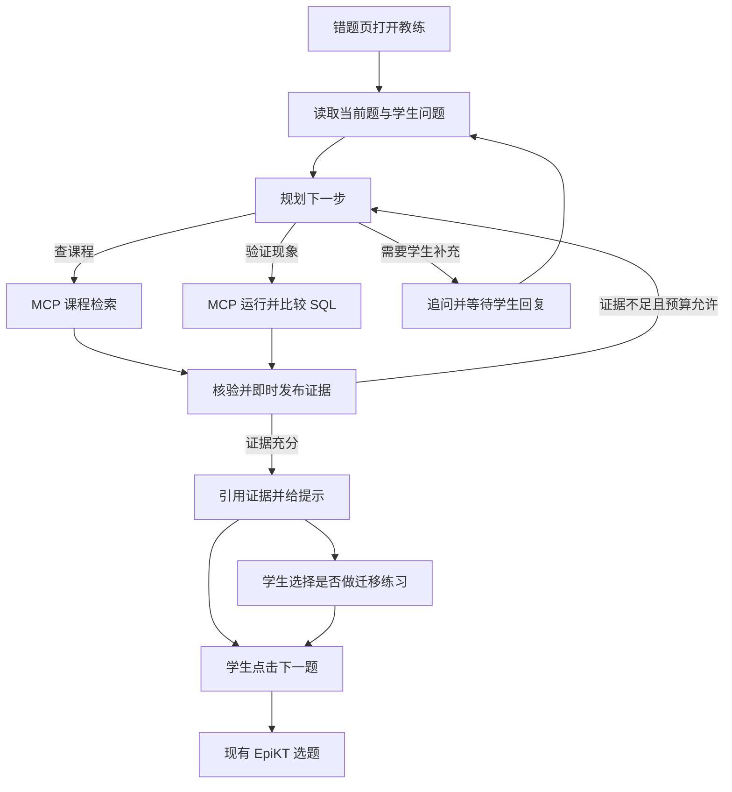

# QueryStep 自主错题教练与课程知识库开发方案

适用基线为 `bac1fcb`。本文供开发和验收使用。文中的工作量、指标和时延均为计划目标。现版数据单独注明。

## 1. 目标与开发边界

学生答错后，可以点击「带我弄懂这题」，用自然语言描述困惑。教练从可引用的课程材料里找规则，按需用 SQLite 验证学生的判断，并根据结果决定继续查证、追问、给提示或引导学生做一次迁移练习。学生完成复盘后，正式下一题仍由现有 EpiKT 权重及选题策略决定。低于最低历史要求或模型异常时，沿用现行规则回退。

| 环节 | 当前版本 | 本轮扩展 |
|---|---|---|
| 课程材料 | 普通助教按考点读取短说明和例题。诊断使用 5 张卡片，按固定主题和词面排序。 | 建设独立课程语料，按章节导入并记录来源。对同一语料比较关键词、向量和混合检索。 |
| 错题辅导 | Gemini 可选课程说明或例题。「运行诊断」固定并行取得课程与实验结果，再尝试补讲。 | 专设自主辅导入口。Agent 根据信息缺口选择工具，并用实际结果修订下一步。快速诊断可随时使用。 |
| 练习与推荐 | 已有 24 道正式题和对应迁移练习。诊断实验入口支持 `HAVING`、`LEFT JOIN`。 | 先用两条现有诊断路线验证新教练。迁移练习复用现有出题与判分接口。课程语料随后覆盖八类主题。 |

医疗助手提供两个直接参考。它先保存本地资料再切分和向量化，Lead 根据用户问题分任务，Worker 可以持续参考工具返回。QueryStep 把这两点用在课程材料的导入和错题查证上。工程目标是让模型决定**需要哪份证据**，让审核课程资料和 SQL 执行决定**能得出什么结论**。 [医疗助手源码分析](<../../examples/居丽叶简历项目7：医疗助手/medix-agent-swarm/PROJECT_ANALYSIS.md>) · [现有诊断](../tutor/diagnosis.py) · [现有课程卡](../course_content/diagnosis_cards.py) · [正式选题](../api/recommend.py)

## 2. 学生体验与演示路径

以正式题 81 的 `LEFT JOIN` 错题为例。学生输入「我只是把右边那个条件挪了一下，为什么没借过书的人少了？那算总人数时会算上他们吗？」

| 学生看到什么 | 系统依据与动作 |
|---|---|
| 「正在查找条件位置和计数规则」，随后看到课程卡和来源链接。 | 根据学生原话、当前考点和含于问题中的两个子问题，检索外连接、`WHERE` 和聚合计数。当前考点帮助排序，同时允许查找关联主题。 |
| 页面展示两条查询和一次实验的实际结果。 | Agent 选一个审核过的案例比较 `ON` 与 `WHERE`。如果首个案例中的记录都匹配且满足条件，两条查询可能返回相同结果。 |
| 如果两边相同，页面显示「当前样例没有未匹配行，改用包含未匹配行的数据」。 | 工具返回的差异和样例属性进入下一步规划。Agent 选择能区分写法的场景。含未匹配行的样例中，右表等值条件位于 `WHERE` 时，该行被过滤。若第一次就获得目标差异，直接利用该观察。 |
| 页面显示哪些行被保留，以及为什么 `COUNT(*)` 和 `COUNT(右表主键)` 可能不同。 | 在同一份合成数据上执行计数对照。引用本轮找回的聚合规则及实际结果。选作对照的右表字段在原表中是非空键。 |
| 学生回答「没匹配的数据行还会参与哪个计数」，然后可点「换一组数据练练」。 | 教练依据回复给提示或结束。迁移题继续由现有模板和 SQLite 判分，独立保存。复习要点由学生确认。 |
| 点击「下一题」，如需对照可打开选题记录。 | 正式选题只读取现行的已判分正式作答。教练会话、SQL 实验和迁移首答各自保存。 |

如果学生只问「NULL 是什么意思」，预期路径为检索并解释。如果学生只说「我没看懂」且无法判断所指，先追问具体是哪个条件或哪一行。第二条演示用 `HAVING`。同一个「大于和大于等于为什么一样」的问题，数据存在刚好等于阈值的组时直接解释差异，否则换含边界组的场景。以上轨迹用于验收，实际顺序由合规的工具结果与学生回答决定。 [SQLite 查询语义](https://www.sqlite.org/lang_select.html) · [SQLite 聚合函数](https://www.sqlite.org/lang_aggfunc.html)

## 3. 课程语料与索引

### 3.1 先建可维护的语料

首批写成独立的中文 Markdown 教学小节，覆盖外连接、`NULL`、`ON` 与 `WHERE`、`COUNT(*)` 与 `COUNT(column)`、分组、`HAVING` 和阈值边界。建议先整理约 8–12 节、形成约 20–30 个检索片段，用数量估算审阅工作量。每节提供一条规则、一个常见误解和一份原创小例子。现有卡片可作为写作素材。SQLite 官方文档提供执行语义依据，PostgreSQL 官方教程提供相应的教学说明，方言差异明确标记。对学生可见的语料保留原始文档链接与章节，采用自主整理的中文文字和项目自建的 SQL 例子。 [SQLite SELECT](https://www.sqlite.org/lang_select.html) · [SQLite 聚合函数](https://www.sqlite.org/lang_aggfunc.html) · [PostgreSQL 聚合教程](https://www.postgresql.org/docs/18/tutorial-agg.html)

每份资料维护稳定 `doc_id`、版本、标题、考点、方言、来源 URL 和章节、查阅日期及审阅状态。按标题及概念切分，保留父标题和例子上下文。尽量让规则、SQL 和结果处于同一片段。允许为精确匹配独立保存 SQL 术语、运算符及同义词。片段用稳定 `chunk_id` 引用，文本变更提升版本。示例附审核过的场景或模板 ID，至少有一条执行回归核对显示结果。语料输入限定为公开依据、自编课程和合成夹具的说明。DBE-KT22 继续用于既有训练与正式题库，学生作答、聊天、复习记录与课程索引分开。

构建脚本验证必填字段、重复 ID、来源定位和例子引用，再生成词法与向量索引。构建产物附语料指纹、切分版本、向量模型及版本、索引参数和片段数量。相同材料重建应保持 ID、版本和条目数一致，同一发布版本按一个索引快照切换。源文档、元数据、构建与测试脚本可随仓库交付，模型缓存和生成索引由环境重建。

### 3.2 在同一语料上比较三种检索

| 模式 | 实现及作用 |
|---|---|
| 关键词 | SQLite FTS5/BM25。入库和查询共用中文分词规则，结构化 SQL 术语字段保留 `COUNT(*)`、`>=`、`LEFT JOIN` 等标记。对符号使用规范化词项或独立精确字段，加入 `>` 与 `>=` 的区分测试。 |
| 向量 | 预计算片段向量。评估本地多语模型 BGE-M3 的中文口语、英文 SQL 和 Mac CPU 开销。小语料先用归一化向量与精确余弦排序，运行时只编码查询。模型和语料版本随实验冻结。 |
| 混合 | 合并两路候选，用 RRF 融合名次，默认参数在开发集确认后冻结。按片段 ID 去重。当前考点作为排序信号，允许其他考点入选。SQLite 与 PostgreSQL 的特定行为先按所需方言匹配。 |

MCP 查询建议带 `query`、`top_k` 和可选考点提示与方言，服务端注入可访问范围。返回 `chunk_id`、版本、片段、来源、匹配模式和可选例子 ID。过滤与证据不足要有明确状态。RRF 名次用于排序。是否值得引用由开发集校准的拒答规则及证据核验共同决定。索引异常时可降到关键词或现有审核卡，工具轨迹标记实际使用的模式。小语料先用本地文件与 SQLite。索引服务和重排模型按实测瓶颈另行评估。 [SQLite FTS5](https://www.sqlite.org/fts5.html) · [BGE-M3 模型卡](https://huggingface.co/BAAI/bge-m3) · [RRF 原论文](https://cormack.uwaterloo.ca/cormacksigir09-rrf.pdf)

## 4. 教练编排、工具和状态

复用 LangGraph 和 Gemini 适配层。规划节点输出结构化的动作清单与目的标签，动作允许查课程、运行或比较实验、追问、给提示或结束。同一模型响应可以提出相互独立的工具动作，LangGraph 可并行委派给检索和实验节点。依赖前一步结果的动作留到下一次规划。工具节点复用 MCP 并校验计划。核验节点依据结果检查引用、缺失信息和预算，再决定是否回到规划。模型可以选择查询和实验路径，事实和引用由服务端限定在本轮真实工具结果。 [LangGraph 编排模式](https://docs.langchain.com/oss/python/langgraph/workflows-agents) · [MCP 工具规范](https://modelcontextprotocol.io/specification/2025-11-25/server/tools)

| 工具 | 参数和返回 | 执行约束 |
|---|---|---|
| 课程检索 | 自然语言、考点提示、方言、返回条数 → 课程片段及稳定引用。 | 首个查询保留学生原话。核验发现证据缺口后允许一次补查。 |
| SQL 实验与比较 | 审核场景、模板、有限参数 → 结果表、行数、差异键及场景属性。新增同夹具比较入口时，一次可运行最多两条预审查询。 | 场景从服务端白名单选择，在合成 SQLite 内只读执行。限制参数、查询数量、输出行数和执行时间。 |
| 教学动作 | 询问、提示、打开已有迁移入口或结束，引用明确的证据 ID。 | 辅导只提出迁移建议，打开与提交继续由学生操作。正式下一题依照现有推荐入口和作答记录。 |

每个教练运行绑定学习者、当前错题决策、历史版本、索引版本和工作流版本。状态包含学生问题与最小必要上下文、已验证的课程片段和 SQL 观察、当前信息缺口、剩余预算与上一步状态。沿用现有事件流的思路，页面展示实际工具、参数摘要、证据与耗时。回放保存动作和结果，供验收与排错。用户追问可恢复同题上下文，提交、超时和切题后复核运行归属，迟到结果不会出现在新题或新会话。复习记录沿用现有确认逻辑。

首版每轮上限为 **3 次模型请求、4 次 MCP 调用和 8 秒主动执行时间**。一次批量对比按一次 MCP 调用计，另记内部 SQL 执行数，最多两条。初步按「初始计划、观察后重规划、可选解释」分配，最后一轮需要时可用审核模板组合已有证据。以服务端时钟统一扣减预算。拿到课程片段或 SQL 结果就发到页面。预算耗尽保留已验证证据，提供追问或快速诊断入口。原快速诊断继续走现行证据优先链路，教练使用独立开关，便于实测后选择默认入口。

## 5. 验证设计和放行条件

现版基线中，证据优先诊断在 24 个固定开发回归案例上有 **23/24 完整诊断**，另有一例主动澄清。本轮重新采集同环境数据，按「需要哪些证据」判定任务完成。简单解释和必要澄清均可判为正确。原 24 题定义仍用于既有快速诊断回归。 [现版实测口径](QueryStep%20多%20Agent%20扩展开发文档.md#142-24-个固定案例的前后对照)

| 层级 | 对照与数据 | 验收口径 |
|---|---|---|
| 课程资料 | 核对首批资料章节、考点和引用链接，对已标审核例子实际执行。 | 全量通过元数据与引用校验，例子有可复现的 SQL 结果。相同材料重复导入无重复条目。 |
| 检索 | 另冻结约 40 条评估查询，覆盖精确 SQL、中文口语、跨考点、方言和库内无答案。人工标必需片段及允许同义证据。现有卡片作产品基线，新增语料的关键词、纯向量和混合检索作同语料对照。 | 报告 Recall@3、跨主题必需证据同时命中率、无答案误引率、P50/P95 延迟。用开发集定参数。混合模式只有在留出集中改善口语或跨考点命中，同时维持精确 SQL 与无答案表现时，才作为默认。 |
| 规划 | 新增约 24 个规划案例，覆盖只查资料、一次实验、根据观察重规划、澄清和故障。对比现有固定诊断、具备相同资料与工具的固定流程、以及自主教练。后两组共用同一模型配置、语料、SQL 场景和预算上限。 | 按实际工具调用与结果判定。报告分组任务完成、重规划命中、无效工具调用、引用支持率、首份证据与最终结果时延和 token 成本。两类指定的成对重规划用例必须通过。默认启用前确认目标场景有收益。 |
| 系统 | 浏览器走通 `LEFT JOIN`、`HAVING`、迁移练习和恢复当前进度。覆盖工具越权、索引缺失、模型超时、无效引用、他人会话、重复请求和掉线恢复。 | 权限、虚构引用、串题写入和正式作答被污染的验收用例全部通过。固定历史下，EpiKT 与规则选择的题号和依据与基线一致。已验证证据可实时呈现，8 秒预算到期可收尾或回退。记录 Mac CPU 冷启动、单请求和三并发的延迟与开销。 |

规划的核心测试使用同一句话和两份首次 SQL 工具返回。第一份已经有边界差异，预期引用它并结束。第二份没有差异，预期补做包含边界的实验。先用固定模型响应做确定性测试，再用真实 Gemini 及真实 MCP 分别对两组初始夹具复跑，核对执行轨迹。检索与规划的收益另外隔离，在教练、模型和工具给定的情况下只换检索模式。学习效果需要另行做学生对照，当前报告的结论以系统行为和证据质量为限。

## 6. 阶段、交付物与工作量

| 阶段 | 任务和依赖 | 交付与放行 | 计划工时 |
|---|---|---|---|
| 0 · 冻结基线 | 保存 EpiKT/规则固定回放、24 例快速诊断基线，定义课程和规划评估格式。 | 可重跑基线，保存配置与记录。 | 0.5–1 人日 |
| 1 · 语料和 LEFT JOIN 验证 | 整理首批源文档、构建关键词索引。补齐普通匹配、未匹配、计数等可区分 SQL 场景。 | 首批可引用课程，SQLite 正反样例全过，同问配对用例可复现。 | 2–3 人日 |
| 2 · 两种检索融合 | 冻结评估查询，构建向量与混合索引，评估 Mac CPU 和同语料对照。阶段 1 输出即为输入。 | 可重复建库脚本、索引清单、检索报告及可解释的默认模式选择。 | 2–3 人日 |
| 3 · 自主教练接入 | 关键词工具接口稳定后可开始编排，先跑通 LEFT JOIN，再用同一套机制接入 HAVING，最后接检索胜出模式。 | 网页入口、证据和实验、重规划轨迹、迁移练习入口、快速诊断回退。 | 3–4 人日 |
| 4 · 验收与扩展 | 跑检索、规划和端到端对照，更新操作手册。报告通过后，把课程语料扩到八类 SQL Core 主题。 | 评估报告、两条浏览器演示路线、工时与问题记录、课程覆盖表。其他主题是否加专门诊断实验按夹具验收决定。 | 2–3 人日 |

建议落点为 `course_content/knowledge/` 保存语料与来源清单，`knowledge/` 保存构建和检索逻辑，现有 `sql_lab/` 增加受限工具接口，教练编排置于 `tutor/`，服务端事件与网页复用已有诊断的模式，评估入口归到 `evals/`。上述目录为拟议结构，开工时按现有模块职责复用。

首版验收的展示物为 **同一句错题提问的两条执行轨迹**、**混合检索的同语料对照**和**EpiKT 选题固定回放**。开发记录保留发现的问题、对应修复、取舍与实测条件。例如，同样的 SQL 运算符如何被分词保留、哪些样例让错误查询得出正确结果、Agent 怎么把工具结果转成下一步动作，以及哪种检索模式在本机的质量和延迟更合适。

## 7. 本地交付与验收记录

### 7.1 已交付

独立语料落在 [课程语料目录](../course_content/knowledge/)，有 12 份以 SQLite 官方文档为依据的中文 Markdown 小节、24 个版控片段，覆盖正式题库的八类 SQL Core 主题。BGE-small-zh-v1.5 的 512 维向量、SQLite FTS5/BM25、RRF 与本地精确向量排名均进入真实 MCP 工具链。首版选用本机已有的轻量 BGE 权重完成对照，阈值仍需在更多真实提问上验证。中文关键词使用重叠双字词项，操作符如 `>`、`>=` 和 `COUNT(*)` 使用独立词项。链接与构建命令见 [本地启动与体验手册](QueryStep%20本地启动与体验手册.md)。模型本身参考 [BAAI 模型卡](https://huggingface.co/BAAI/bge-small-zh-v1.5)。

自主错题教练已接入当前网页的 81 号和 75 号错题反馈，包含检索、SQL 对照、基于结果切换边界数据、引用、刷新后的记录恢复和次轮追问。原有快速诊断和 24 道题的迁移练习继续走各自路由。证据逐步写入单独的运行记录，浏览器轮询展示。服务端使用单应用进程管理 MCP 生命周期和学生隔离，租约与跨进程接续未纳入当前验收。

### 7.2 检索实验

38 条项目自编问题。表内指标使用 Top 3 返回。此集合用于首轮开发和阈值调整，数值应视为开发样本表现。混合模式下，已有课程没有答案时有 2 个问题仍召回了无关资料，跨考点两份依据齐备率为 3/8。

| 检索 | 精确 SQL 命中 | 口语改写命中 | 跨考点两份证据齐备 | 无答案却返回片段 |
|---|---:|---:|---:|---:|
| 现有卡片 | 4/8 | 4/10 | 0/8 | 6/10 |
| 同语料关键词 | 8/8 | 6/10 | 1/8 | 2/10 |
| 同语料向量 | 4/8 | 6/10 | 2/8 | 3/10 |
| 同语料混合 | 8/8 | 7/10 | 3/8 | 2/10 |

混合检索各题组热运行 P95 约 3.56–3.72 毫秒，仅累计检索查询耗时，MCP 往返和首次模型加载另计。复现入口为 `python -m evals.course_search`。逐条输出保存在本地 `artifacts/coach/retrieval-expanded.json`。

### 7.3 重规划和原链路回归

成对对照使用真实 Gemini、混合检索和 SQLite。固定流程拥有相同工具，且始终运行两个实验。自主教练在第一次已发现差异的两个案例中均省去第二次 SQL 对照。在两组首次结果相同的案例中，模型依据工具返回选择含边界数据的样例。每轮完整输出如下。

| 考点及首组结果 | 自主教练实际观察 | 固定 / 自主 MCP 调用 | 自主总时延 |
|---|---|---:|---:|
| LEFT JOIN 相同 | 相同 → 不同 | 3 / 3 | 4.01 秒 |
| LEFT JOIN 不同 | 直接利用差异 | 3 / 2 | 2.83 秒 |
| HAVING 相同 | 相同 → 不同 | 3 / 3 | 4.81 秒 |
| HAVING 不同 | 直接利用差异 | 3 / 2 | 2.67 秒 |

本轮是四个合成机制验证样本，固定流程由确定性代码驱动，可提供工具开销下限。自主模式时延主要包括真实网关调用。结果无需外部评审即可核对 SQL 行差异。复现入口为 `python -m evals.coach_paired`，原始输出保存在本地 `artifacts/coach/paired-current.jsonl`。另用 24 个合成规划案例检查定义、重规划、澄清及越权。混合检索组复跑通过 21/24，总响应 P50 为 2.45 秒、P95 为 3.48 秒。10 个指定实验案例均通过。未达预期的是 1 条只需解释分组的问题和 2 条模糊提问。详见本地 `artifacts/coach/planning-holdout-hybrid-rerun.json`，复现入口为 `python -m evals.coach_holdout`。真人学习效果留待单独实验。

旧版快速诊断在原 24 例回归上维持 23 次完整诊断和 1 次澄清，P95 为 249 毫秒。Chromium 验证两个网页路线从 EpiKT 正式选题开始，执行相同到不同的 SQL 对照，刷新恢复，另一学习者无法读取。原有迁移与作答回看也通过浏览器回归。原权重 `c31ae1ebdda8` 的正式题选题回放覆盖 108 位学习者的 1,957 个有效前缀，报告与之前逐字节相同。

端到端关键词组也通过 21/24，P95 为 3.56 秒。两组相同的完成率仅说明本次教练对照未测得完成率提升。混合模式的收益集中在单独的检索实验中。

开发排错记录包括两件事。网关可能将规划 JSON 放进 Markdown 围栏，服务端剥离单个完整围栏后继续进行 schema 校验。模型可能把「本组结果一样」误当成解释完成，服务端将缺失的边界场景反馈给规划器，并用预算和结果校验控制最终输出。已经核验的证据在超时时保留。
