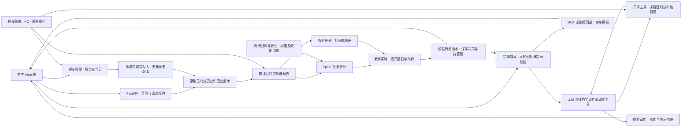

# QueryStep｜EpiKT 驱动的数据库练习 Agent 项目计划书

**扩展进度（2026 年 11 月 13 日）。** QueryStep 已用正式 DBE-KT22 权重完成选题、规则对照与 Gemini 辅导联调。多 Agent 错题诊断与跨会话学习记录可在本地启用。扩展范围和技术选型见第 7 节，实际验收和复现命令见配套开发文档第 13 节。第 1–6 节保留原项目的研究背景、选题策略与首版设计。 [多 Agent 扩展开发文档](QueryStep%20多%20Agent%20扩展开发文档.md)

**修订评审稿 · 2026 年 11 月 10 日 · 含匿名研究材料，仅供内部评审**

## 1. 一页项目概要

| 项目 | 立项建议 |
|---|---|
| 目标用户 | 正在学习关系数据库的本科生和成年转专业学习者。首版做中文界面，练习题使用原创或获准展示的题目。 |
| 核心痛点 | 学生做错一道 SQL 题后，需要决定是补一个先修概念、再做一道同类题，还是继续挑战。单次答错很难区分偶发失误和持续困难，而反复看原题解析也无法检验能否迁移。 |
| 推荐方案 | 做一个可跨会话继续的 SQL 练习 Web 应用。**EpiKT 根据已判分历史为候选评分，教学策略据此决定学生实际看到的下一题。完整版必须接入真实 LLM 教学 Agent**，由它根据学生回答选择追问、提示或例子，调用工具并依据工具结果调整教学动作。服务端负责判分。 |
| 可证明的差异 | 做两组独立对照。固定辅导方式和候选池，比较 EpiKT 与规则评分是否改变下一题。固定练习题和可用资料，比较模板辅导与 LLM Agent 的提示质量及适应性。各自保留可重放记录，学习收益通过单独试验评估。 |
| 当前可行性 | **有条件立项。** DBE-KT22 官方 V1 已下载并核对四份文件，协议允许分析建模。学生题库及在线模型的使用范围仍需落实。你预计手头有 ASSIST、POJ、NIPS34 等现有 checkpoint，尚待核对其配置与映射。可先做原域推理验收，SQL 上线仍需同域模型。方案独立于匿名稿的录用结果。 |
| 三项立项条件 | **① 数据**锁定可展示的题库和允许用于目标场景的真实时序日志。**② 模型**确认现有 checkpoint 的复现条件，并明确 SQL 权重的训练和使用路径。**③ 验收**通过防泄漏、离在线一致性和候选覆盖后启用 EpiKT 选题，完整版同时通过 LLM 工具调用及多轮辅导验收。 |

### 公开调研与方向选择

公开来源统一查阅于 **2026 年 11 月 9 日**。产品能力按官方材料所描述的范围记录，内部选题逻辑和学习效果分别看证据。

| 代表产品 | 公开材料能确认的能力 | 与本项目的关系 |
|---|---|---|
| Khanmigo｜AI Tutor | 提供辅导对话。帮助中心显示登录后可以查阅、恢复过去的对话，历史记录可关联课程或活动。 | 聊天连续性已有成熟范例。所引材料能确认恢复对话，尚无法据此复现“同一错题之后为何选了某一道题”的决策。 [产品页](https://www.khanacademy.org/khanmigo) · [聊天历史说明](https://support.khanacademy.org/hc/en-us/articles/39031073265421-Where-can-I-find-my-Khanmigo-chat-history-in-Khan-Academy-Reimagined) |
| Photomath｜答疑 | 扫描或输入当前题，查看逐步解法，有些题提供多种方法。 | 适合即刻解惑。所引页面覆盖单题帮助，跨会话作答证据如何触发后续练习超出该页面的证据范围。 [官方功能说明](https://photomath.com/) |
| IXL、Duolingo｜自适应练习 | IXL 持续更新诊断水平和下一步技能计划。Duolingo 公开描述用学习表现适配题目难度与顺序，也提供错题练习。 | 难度适配、跨次进度和错题复练已有先例。可检验的改进空间是把本项目的**单次错后路由**做成可审计决策，并单独估计更换评分器的影响。 [IXL Diagnostic](https://www.ixl.com/diagnostic/info) · [Duolingo 自适应课](https://blog.duolingo.com/keeping-you-at-the-frontier-of-learning-with-adaptive-lessons/) · [错题练习](https://blog.duolingo.com/ways-to-practice-in-duolingo/) |
| DataCamp｜同领域 AI Tutor | 官方说明介绍随水平和目标调整的课程、实时反馈，以及在完成章节后根据课程内容生成的巩固练习。 | 是最直接的同领域参照。公开文档展示了学习闭环，未披露可供复跑的逐题候选分数及固定候选池下的评分器对照。 [AI Tutor](https://datacamp.zendesk.com/hc/en-us/articles/39923800087703-Introducing-the-AI-Tutor-Experience) · [Practice](https://datacamp.zendesk.com/hc/en-us/articles/28562143877015-DataCamp-Practice-Reinforce-Your-Learning-with-Hands-On-Exercises) |
| OATutor｜开放研究系统 | 开源实现已有 BKT 选题、提示与脚手架、可持久化的交互日志和可配置 A/B 分组。 | 它证明「用 KT 选题」已有先例。QueryStep 分别检验 EpiKT 是否改变错后选题，以及 LLM 多轮辅导是否根据学生回答调整教法。 [OATutor 实现](https://github.com/CAHLR/OATutor) · [CHI 系统论文](https://doi.org/10.1145/3544548.3581574) |

公开实验也支持把“做题时表现”和“之后独立作答”分开。Bastani 等在高中数学现场实验中分别测量了有 AI 的练习和撤掉 AI 后的考试。Pardos 与 Bhandari 在 OATutor 上随机比较提示来源，并单独质检生成内容。两项研究为本项目的**无提示后测和提示审核**提供设计依据，SQL 课程中的效果由本项目另行估计。 [高中数学随机实验](https://pmc.ncbi.nlm.nih.gov/articles/PMC12232635/) · [OATutor 提示实验](https://journals.plos.org/plosone/article?id=10.1371/journal.pone.0304013)

| 候选方向 | 数据、可评估性与工程取舍 |
|---|---|
| **关系数据库基础｜推荐** | DBE-KT22 公开论文列出可关联的原题、选项、KC、难度和按学习者排列的答题数据。客观题可确定性判分，学生能直接感知补基础、同类巩固和进阶的差异。首版可以把工时集中在数据映射、真实推理、状态和实验。 [DBE-KT22 数据说明，§3](https://arxiv.org/html/2208.12651#S3) |
| 初中代数错后练习 | Eedi NIPS34 贴近原稿评估，但原题图片仅供模型训练。FoundationalASSIST 的题干、作答和技能能按 `problem_id` 对齐，但需申请访问，有机构存储等条件，标签也包含是否获得辅助。直接做成可分享题库的前置条件更多。 [Eedi 图片条款](https://www.eedischool.com/projects/neurips-education-challenge) · [FoundationalASSIST 数据卡](https://huggingface.co/datasets/ASSISTments/FoundationalASSIST/blob/main/README.md) |
| 编程 OJ 错后推荐 | POJ 提交结果适合做难度路由，但补充 KC、核对题面授权和实现隔离判题都要额外投入。较难在首版将变化归因于选题，而非编译或运行环境。依据为本地附录 Dataset Descriptions 和 `poj_preprocess.py`。 |

## 2. 范围与体验

| 范围 | 学生能用的功能 | 验收边界 |
|---|---|---|
| **MVP（最小可行产品）** | 一个单元、固定起步题、客观判分、错后推荐、审核过的模板提示和跨会话继续。题库目标 24–40 道、覆盖约 4–6 个已验证 KC，实际范围以数据审计为准。 | **真实训练权重必须参与错后下一题决策。** 带标识的模拟前缀可证明接线，最终须用同域真实留出前缀复放，并让学生自己的已判分记录进入在线推理。 |
| **完整作品版** | **真实 LLM 教学 Agent 为必交功能。** 学生能用自己的话解释思路，Agent 能选追问、提示或例子，调用课程工具，根据工具结果及下一轮回答改变教法，再衔接 EpiKT 已选好的练习。提供练习历史、引用和按权限查看的决策回放。 | 演示一段真实 LLM 的多轮工具轨迹和学生端动作变化。交付 EpiKT/规则选题与 LLM/模板辅导两组独立对照，以及接口测试、部署包、运行看板和版本回滚。相邻单元按数据覆盖安排。 |
| **可选扩展** | 有独立判分需求时加入隔离执行的 SQL 编写题。积累足够数据后做复习调度或教师看板。 | 新题型和新决策分别验证。开放题、随机化策略优化和多 Agent 协作在出现相应需求后再评审。 |

### 一条完整学生案例

小林会写 `SELECT`，但第一次练习 `LEFT JOIN` 时，看不出右表条件放在 `ON` 和 `WHERE` 对未匹配行有什么影响。以下题目、概率和阈值均为**方案示例**。

| 阶段 | 小林看见什么 | 系统做了什么，依据是什么 |
|---|---|---|
| 首次进入 | 选择「掌握表连接」，完成三道不带提示的起步题。 | 服务端按选项 ID 判分，保存完成顺序和题目版本。历史不足时执行固定起步路径。 |
| 第一次错题 | 做错一道连接题，收到「先练一道保留未匹配行的基础题」，可展开一条提示。 | 策略从同一已判分历史取三个合规候选。基础 B、同类 S、进阶 A 的 EpiKT 题目分数假设为 `0.76 / 0.43 / 0.32`。进阶与同类未达阈值，系统选择 B。可展开提示针对刚做错的题，由审核材料约束。 |
| 同一回合做对照 | 评审者可在回放界面看到规则版给出的下一题。 | 固定同一历史、B/S/A、先修条件和策略参数。规则评分若为 `0.78 / 0.64 / 0.42`，同一策略会给 S。对照差异是 **B 与 S**，可以检查展示的 `item_id` 和原因码。回放分数不记为学生作答。 |
| 多轮辅导（完整版） | 小林说「我以为放在 `ON` 和 `WHERE` 都一样」。Agent 问「右表没匹配时，左表那一行先保留吗？」若小林仍卡住，Agent 展示审核过的两行示例，再邀请他继续做 B。 | LLM 先调用课程规则检索，再根据小林的第二轮回答决定是否调用例题工具。工具结果约束提示内容，B 仍来自已保存的 EpiKT 决策。辅导文字保存在会话，正式提交后的判分才进入模型历史。 |
| 练习与离开 | 小林独立答对 B，刷新后仍看到已完成。 | 判分事务提交一条新事件，历史版本递增。错题提示、评分和聊天分开存储。 |
| 次日回来 | 「上次已完成基础练习，继续表连接」并打开新的同类题。 | 恢复课程目标与最新已判分历史。根据新历史重评未见候选。假设同类 S 为 `0.71`、进阶 A 为 `0.51`，策略转为同类巩固。系统可显示“已完成基础练习”的事实。 |

**首版策略提案。** 先按课程目标、题目授权及版本、先修要求、近练去重和模型覆盖筛候选。题目 ID 模式按候选题的预测答对概率选题，当前实现见下节。KC 模式是备选方案，可用分数选择练习方向，再按已审核难度和题号在组内决胜。缺少合规候选时给审核提示并回到课程计划。EpiKT 影响的是**选哪一道练习**。学生在错题反馈页可主动请求提示。

### 选题对照的评分公式与参数来源

线上对照使用同一份已判分历史、同一批候选题和同一套选题策略。EpiKT 提供校准后的候选题答对概率。普通规则提供基于题目难度和近期同主题作答的平滑分数，也用于模型不可用时的回退。 [在线评分与对照实现](../api/recommend.py#L15)

普通规则为每道候选题计算分数。令 $p_0$ 为候选题难度档的初始分数，$n$ 为该生最近最多 5 次同主题作答的次数，$s$ 为其中答对的次数。这里的主题是题库给题目标注的 SQL 主题，例如筛选或聚合。

$$
\text{规则分数}=\frac{3p_0+s}{3+n}
$$

该公式在形式上对应 Beta–Binomial 平滑。取 Beta 先验参数 $\alpha=3p_0$、$\beta=3(1-p_0)$，观察 $n$ 次二值作答，其中 $s$ 次正确，得到的后验均值就是上式。权重 3 相当于给难度先验三次虚拟作答的权重，避免少量历史让分数直接变成 0 或 1。Pavlik、Cen 和 Koedinger（2009）的 PFA 也用同知识点的历史答对和答错次数预测后续表现，其两类作答的权重由数据拟合。这里引用 PFA 作为使用历史作答信号的先例。 [UC Berkeley《Bayes Estimation》§3](https://stat210a.berkeley.edu/fall-2025/reader/bayes-estimation.html) · [PFA 原论文，式 3](https://pact.cs.cmu.edu/koedinger/pubs/AIED%202009%20final%20Pavlik%20Cen%20Keodinger%20corrected.pdf)

| 评分参数 | 当前值 | 来源与用途 |
|---|---|---|
| 难度初始分数 $p_0$ | 基础 0.76、巩固 0.64、进阶 0.51 | **项目自定。** 缺少同主题历史时直接用它打分，让更难的题有更低的起始分数。这些数值未经 DBE-KT22 拟合。 |
| 先验权重 | 3 | **项目自定。** 控制难度初始分数对少量作答记录的影响。文献给出平滑形式，权重由项目选定。 |
| 历史窗口 | 最近最多 5 次同主题作答 | **项目自定。** 给近期表现更直接的影响。具体窗口长度尚未做对照验证。 |

例如，巩固题所在主题最近作答 2 次、答对 1 次，规则分数为 $(3\times 0.64+1)/(3+2)=58.4\%$。同主题、同难度的候选题得到相同的规则分数。第 4.1 节的离线「题目训练集先验」和「平滑近期 KC 正确率」另外使用训练数据统计先验。 [规则打分代码](../api/recommend.py#L15) · [离线基线代码](../evals/kt_baselines.py#L64)

### 教学策略的排序目标与准入门槛

当前策略按「进阶、巩固、基础」依次检查候选。进阶要求最近 5 次作答中，当前主题至少答对 2 次，并要求该进阶题的分数落在 **65%–85%**。巩固题的分数须达到 **55%**，基础题可从合规候选中选。在第一个有合格题目的档位内，选分数最接近 **75%** 的题，距离相同则按题号从小到大决定。EpiKT 和普通规则共用这些参数。 [候选筛选代码](../api/recommend.py#L96) · [档位与排序代码](../api/policy.py#L17)

| 策略参数 | 设定理由与证据 |
|---|---|
| **75% 排序目标** | **有文献先例，QueryStep 取作首版默认值。** 设计意图是让学生有较大机会答对，同时保留一定挑战。75% 也是项目设定的进阶区间 65%–85% 的中点。Klinkenberg 等人（2011）的 Maths Garden 在小学算术练习中按平均预测成功率 75% 抽题。Jansen 等人（2013）比较了 60%、75%、90% 三档，在该算术实验中，较高目标成功率的组尝试了更多题，数学成绩提升也更大。两项研究支持采用目标成功率作为可比较的设计变量，SQL 场景的适宜目标仍待验证。 [Maths Garden 原论文](https://doi.org/10.1016/j.compedu.2011.02.003) · [成功率对照实验](https://doi.org/10.1016/j.lindif.2012.12.014) |
| **55% 巩固题下限** | **项目自定。** 巩固题的准入比 75% 排序目标宽松。分数低于 55% 的巩固题会被排除，没有合格进阶题或巩固题时转向基础题。现有调研未找到直接支持 SQL 巩固题采用 55% 的文献，55% 相对 50% 或 60% 的效果也尚未验证。 |
| **65%–85% 进阶区间** | **项目自定。** 在满足近期作答条件后，把进阶限定在首版设定的成功率区间内。区间边界尚未通过 SQL 学习效果实验验证。 |

本节参考资料查阅于 **2026 年 11 月 13 日**。

## 3. 技术方案

### 3.1 架构与工作流



**外层由服务端编排。** 每次选题保存 `trace_id`、学生作用域、`goal_id`、`history_version`、题库与模型版本、候选、策略、评分来源、下一题及回退原因。模型调用在数据库事务外执行。发布待答题时再次检查历史版本和已有待答题。若历史已变化，弃用过期分数并从新快照重算一次，竞争未消失则返回可重试状态。页面刷新优先恢复有效的待答题。

**内层由 LLM 教学 Agent 执行。** 学生在错题页发言或点「问辅导」，服务端读取当前错题、简短会话上下文和提示阶段。LLM 返回结构化教学动作，或发起只读工具调用；工具结果回填后由 LLM 继续判断。学生答复进入下一辅导轮，可触发由追问转为提示或例子。每轮最多调用 LLM 三次、工具两次，超限或异常转审核模板。Agent 可以邀请学生继续练习，学生确认后由服务端呈现已选下一题。切换题目后丢弃旧辅导请求的迟到结果。辅导轨迹关联 `decision_id`，记录模型与提示词版本、动作、工具名和结果引用、延迟及回退原因。评审回放使用经筛选的内容或测试账号。

| 节点或工具 | 参数与返回 | 权限和失败处理 |
|---|---|---|
| `load_history` / `list_candidates` | 服务端作用域、`goal_id`、窗口、题库版本 → 已确认历史、版本、候选 ID 与约束原因 | 历史仅可读。候选由课程服务给出，题干或聊天中的文字无法增删候选。 |
| `score_candidates` / `choose_action` | 已冻结的快照与候选、截止时间 → 每题状态和分数 → `practice_foundation / consolidate / advance / guided_review`、题目 ID、原因码 | 评分器无业务数据库写权限。策略校验题目和动作，检查历史版本后由编排器写决策。超时转规则。 |
| `retrieve_course_notes` | `kc_id`、`topic`、`top_k` → 版本化课程片段与来源 ID | 只搜当前课程的白名单。服务端检查 KC 和检索上限，引用限定在本轮实际结果。 |
| `get_worked_example` | `kc_id`、`example_type` → 审核过的独立例题、最小数据表和预计算结果 | 只读白名单例题。练习作答阶段仅提供与当前题分离的示例，工具无数据库执行权限。 |
| `select_tutoring_action` | LLM 结构化输出 `ask_clarifying / give_hint / show_example / invite_practice`、正文、来源 ID | 服务端验证动作、提示阶段、引用和文本。越权、无命中、超时或疑似泄露答案时切换模板。下一题 ID 由已保存决策提供。 |
| `submit_answer` | `presentation_id`、`item_version`、`option_id`、幂等键 → 判分结果和新历史版本 | 仅学生通过提交端点触发。判分服务核对题目所有权、有效状态及答案键，按固定逻辑判分。相同请求返回原结果，同键不同答案冲突。 |

**学习记录。** PostgreSQL 分表保存 `graded_attempts`、`presentations`、`decision_runs`、`chat_messages` 和题库版本。判分事务锁定待答题并校验学生归属，利用 `presentation_id` 唯一约束和学生范围内的幂等键，原子提交成绩、状态和递增的服务端事件序号。两端同时提交时只接受首个有效提交。过期待答题返回冲突并恢复当前题，已成功提交的网络重试仍返回原结果。已判分的辅助作答和重做可以显示在记录中，模型视图只取符合训练定义的独立首答。草稿、预测和对话各走各的存储路径。

**数据访问。** 学生只能读自己的会话、待答题和结果。服务端检查资源归属，完整作品版增加数据库行级策略和越权测试。评分器只收模型需要的 KC、题号（仅在题号模式）、二值标签与快照引用。LLM 只收当前获准展示的题面或摘要、提示阶段、经筛选的本轮发言和必要的会话上下文，以及本轮工具返回的审核材料。发送给模型的资料排除学生身份、原始历史、DBE-KT22 原始内容、门控、答案键和匿名稿件。Agent 的教学动作写入辅导轨迹，已判分账本只由服务端提交端点写入。

### 3.2 EpiKT 推理契约

| 字段 | 映射与张量 |
|---|---|
| 历史 | 服务端提供有序的 `event_id, item_version, item_id, ordered_kc_ids, correct, event_seq`。每条已完成原题只在数据库写一次。模型适配器按训练顺序展开其各 KC，复制已知判分结果，并保留事件归组。 |
| `q_data` | `LongTensor[B,T]`。取 KC 映射中的索引，范围 `[0,num_c)`。虽命名为 `q_data`，pyKT 实际传 `cc`，即 KC。`init_model` 把 `num_c` 传给 `n_question`。 |
| `target` | `LongTensor[B,T]`。历史为服务器判分的 `0/1`，候选末位先用合法占位 `0`。此位置的占位只在前向张量内存在。 |
| `pid_data` | `LongTensor[B,T]` 或 `None`。题号模式用独立题目词表，合法业务索引 `[0,num_q)`，`num_q → n_pid`。`n_pid>0` 才使用可学习题目难度项。KC 模式以 `num_q=0` 训练及部署，传 `None`。ID `0` 是合法业务索引。 |
| 输出 | `preds[B,T]` 的 `[b,t_goal]` 是该行目标的作答正确概率，`t_goal` 为追加前的有效历史长度。原生默认返回 `(preds, c_reg_loss)`，`qtest=True` 增加 `concat_q`。评分响应返回 `item_id`、各 KC 概率、聚合分数、已验证的校准分数、评分粒度、窗口和版本。题号模式以题目为评分目标。KC 模式以概念为目标，策略用 KC 分数决定补哪个基础、巩固哪个概念或是否进阶，题目由组内固定规则选出。 |

服务使用 `model.eval()` 和 `torch.inference_mode()`。每个目标 KC 独立构造 `已确认历史 + 当前目标`，同一快照、同一截断；首版优先按实际长度成批，同一轮各候选行天然等长。原 `forward` 有因果掩码，缺少独立的业务 padding mask。若以后合并不同长度请求，采用右填充合法索引和标签，在适配层保留 `valid_len`，只读目标下标，并在一致性测试通过后启用。pyKT CSV 的 `-1` 是预处理哨兵，`KTDataset` 用掩码构造移位序列，原评估读取 `preds[:,1:]` 后再按 `smasks` 选位置。在线直接读取原始目标下标；空历史走冷启动，短历史测试另行覆盖。

**多 KC 题的计算口径。** 设候选题 J 有两个 KC，构造 `H + (J,k₁,0)` 和 `H + (J,k₂,0)`，两行共享历史 `H`。KC 模式省略张量中的 `J`，服务端仍保留它用于归组。**模型内部**先对同一 KC 的多尺度分支 logits 做门控加权，再 sigmoid。**模型外部**才对同一原题的各 KC 概率取均值。题号模式以题目级结果校准；KC 模式同 KC 组合的题会得到同一模型分数，组内难度由审题和已有校准证据约束。

本地 `expand_question` 在每道原题开始时截住 `dlast`，为目标的各 KC 复用该前缀。`group_fusion` 按 `qidx/rest` 归组，`late_fusion` 的 `late_mean` 将均值四舍五入到四位。AL2005、BD2006、NIPS34 用题目窗口 `test_question_window_sequences.csv` 的 `windowauclate_mean/windowacclate_mean`；POJ 用普通 `test_window_sequences.csv` 的 `window_testauc/window_testacc`，其题号在预处理中充当概念 ID，无独立题号难度分支。线上沿用相同前缀和概率均值语义，保留全精度，并优先以完整作答事件为截断单位。恰遇多 KC 跨窗边界，线上与 pyKT 逐 token 截断可能得到不同历史，评估分别输出论文复现口径和产品口径。普通的展开序列也可能把同题的已知标签带给后一个 KC，产品训练与验证用原题归组的目标前缀规避这一点。

**窗口、降级和并发。** 初始以 `T≤200` 为基准，包含候选一个位置，最多保留 199 个已确认的展开位置。按最新的完整事件回取，比较 50、100、200 长度下的分数漂移、策略变化、校准和 P95，再决定是否缩短。短历史不足三次合格作答时显示「正在建立练习记录」，使用固定起步题。候选 KC 未知或无训练支持时排除该题。题号模式额外检查题号词表与训练支持，KC 模式以题库版本和有效 KC 映射检查题目。若历史出现不可映射事件，按数据契约标记为规则模式并记录原因，避免静默拼接历史。缺权重或推理超时显示「本轮使用基础推荐」，仍可作答和续学。迟到推理结果不能覆盖已发布动作。MVP 优先做轮内批量评分；如压测需要缓存，按学习者作用域、历史版本、题库/映射、模型/校准、窗口及目标签名取键，任一版本变化即失效。`last_branch_gates` 是模型实例状态，在线默认不采集。调试时在隔离实例中运行，或在同一锁内完成前向、复制并绑定请求 ID，再释放实例。

### 3.3 数据、权重和环境

**离线研究数据。** DBE-KT22 官方 V1 的原始 CSV、序列 JSON、生成脚本和字段说明已下载并核对。作者论文报告 212 道题、98 个 KC、1,361 名学生及 167,222 条交互，属于公开报告值。已接受的 ADA 协议将材料使用限于分析用途，包括作为模型输入。涉及非分析用途或向未受协议约束的人提供原始内容，须取得 ADA 书面许可。DBE-KT22 先用于本地预处理、训练及离线评估。将其原题用于学生端或将用其训练的权重用于拟议的在线场景，均应先向 ADA 核实使用范围，并按适用条件取得书面许可。 [本地官方文件](</Users/felixyan/Desktop/实习/projects/QueryStep/data/DBE-KT22>) · [DBE-KT22 论文与发布清单](https://arxiv.org/html/2208.12651#S3.SS5) · [ADA 官方存档及 Terms 页签](https://doi.org/10.26193/6DZWOH)

**学生题库与上线权重。** 默认使用原创或有明确展示权限的题目与例子。若获得 ADA 对拟议题库和上线场景的许可，可用同一题库的真实作答训练题号模式，按学习者划分，留出组仅用于评估。若未取得对应许可，独立采集经同意的成年志愿者在原创或获准题库上的真实作答，用来训练、校准和留出评估上线模型。采集前可用规则推荐验证交互，真实 EpiKT 选题通过后才算 MVP。数据量较小时可先评估 `num_q=0` 的 KC 模式，由 EpiKT 选练习方向，服务端在该方向的合规题中选出具体题。若训练、校准或覆盖仍不足，则延长采集或缩小单元，并记录对进度的影响。

**预处理。** 核对 `Transaction.csv` 到 `Questions.csv`、`Question_Choices.csv`、`Question_KC_Relationships.csv` 和 `KCs.csv` 的连接。按可验证的事件顺序处理并列、重复、辅助和多次提交，首版采用无提示首答。保留 `source_item_id → item_version → model_pid`（题号模式）和 `source_kc_id → model_kc` 的映射清单。学生题库另审题干、答案、主/辅 KC、难度和先修关系。难度标签和训练集通过率分开存储，真实历史、模拟轨迹和自编题分别标记。每个上线候选都需达到所选评分粒度的支持与覆盖要求。

本地 ASSIST2015 的原始 CSV 只有 `user_id/log_id/sequence_id/correct`，预处理用 `sequence_id` 作概念，`num_q=0`、`num_c=100`，适合概念级训练冒烟、窗口和设备测试。原稿四套数据的复现仍需配套原始文件或兼容缓存。AL2005、BD2006 的题号是题目名与步骤名拼接，NIPS34 有题号及三级主题 KC，POJ 用题号代理概念。用户预计已有部分基准 checkpoint，可优先复现原域推理。SQL 迁移可另设实验，比较从零训练与复用兼容的编码器和检索层、重建 SQL 嵌入及难度参数的初始化方式。两者用同一学习者留出集评估。

| 权重路径 | 工作量与算力估计 | 验收 |
|---|---|---|
| **A · 取得兼容权重** | 用户提供可信训练产物后，预留 1–2 人日核验清单，CPU 和单卡各跑一组基准样本。 | `<emb_type>_model.ckpt` 与 `config.json`、有效模型超参、`keyid2idx`、数据集和切分指纹、`num_q/num_c`、`emb_type/n_scales/ablation`、seed、fold、代码版本及权重哈希配套。严格加载、已知样本分数对齐并过泄漏测试。同一模型文件形状兼容但词表不同，拒绝启用。同域且覆盖上线题的权重才参与选题，原稿权重可先用于对应基准。 |
| **B · 训练同域权重，预计主路径** | 数据就绪后预留 5–8 人日。DBE-KT22 先作为离线数据，在线权重按上方许可与数据路径确定。建议先在单张 16–24 GB NVIDIA 卡上试 `n_scales=2`、较小宽度，测显存和每 epoch 时间。为首轮试跑预留 2–4 GPU 小时，为有限配置、基线和复跑预留 12–36 GPU 小时，达到 48 GPU 小时前按实测复评。 | 训练、验证和校准均记录切分与样本计数，检查点来自验证集选型，留出测试独立。交付锁定配置、指标、分数样本和可加载制品。若校准或数据覆盖未达标，模型先做影子评分，学生端继续规则推荐。 |

**环境区分。**

- **匿名稿报告。** 正文 Experimental Settings 及附录表 2 采用 PyTorch、Adam、最长 200、最多 200 epochs、验证 AUC 早停耐心 10，按 fold 用贝叶斯搜索。报告采用 ALiBi，`n_scales` 搜索 2–4，含 level 0。论文基准配置与 DBE-KT22 产品训练分开记录。
- **脚本实况。** `wandb_epikt_train.py` 默认 `algebra2005 / qid_alibi / fold 0 / seed 3407 / n_scales 2`，`d_ff=512`，与附录搜索空间不同。`kt_config.json` 的基础批量 256 在 `wandb_train.py` 对 EpiKT 改为 64。`seedwandb/epikt.yaml` 写的是当前数据配置没有的 `xes`。`train_model` 在验证 AUC 提升超过 `0.001` 时保存权重，十轮未刷新则早停。另有相对路径、W&B 默认开启、预处理删缓存和 loader 写 pickle 的行为。后续在独立工作目录运行，锁定产物和数据版本。
- **部署方案。** 后续创建独立 Conda 环境，Python 3.11 作为首选候选，用官方匹配主机驱动的 PyTorch wheel，锁定 `torch/einops/numpy/pandas/scikit-learn` 等依赖。Linux + NVIDIA CUDA 是复现及训练首选。`qid_alibi` 原实现初始化直接 `.cuda()`，固定最大位置 1000，且掩码和部分张量依赖模块级 `device`；原 `load_model` 也无 `map_location`。CPU/Apple Silicon 路径计划将 ALiBi 常量改成可随设备移动的非持久 buffer，临时张量从输入取设备，以显式 `map_location` 严格加载同一 state dict，先在 macOS ARM CPU 上验证，再试 MPS 的 `searchsorted`、卷积、掩码和数值对齐。单独训练的 `qid` 可做 CPU 冒烟，保留其与 `qid_alibi` 的配置区别。固定 FP32 作为首轮对齐基准。部署采用 Docker Compose、API 与单独评分进程、PostgreSQL、只读模型制品；启动核对哈希与固定样本，提供健康检查、降级状态和回滚。 [PyTorch 安装说明](https://docs.pytorch.org/get-started/locally/) · [MPS 后端说明](https://docs.pytorch.org/docs/2.15/notes/mps.html) |

### 3.4 Agent 选型和目录

| 技术 | 解决的问题与落点 | 选择理由、替代方案和阶段 |
|---|---|---|
| PyTorch + 薄 pyKT 适配层 | 训练、窗口打包、真实评分 | 复用研究模型和原评估参考。首阶段直接使用 PyTorch，压测有明确瓶颈时评估导出。 |
| FastAPI + Pydantic | API、候选和工具参数校验、分阶段超时 | Python 同栈，接口可生成文档。MVP 引入；原型也可先用 CLI 做评分一致性。 |
| 显式 Python 工作流 + 单 LLM Agent | 外层选题、判分和持久化；内层多轮辅导、工具结果回填、预算与回退 | MVP 先交付外层。完整版实现单 Agent 及其状态机，便于按步骤重放。若工具链扩展到长时中断恢复或人工审核，再评估 LangGraph。 |
| PostgreSQL | 题库、判分账本、版本、实验和权限 | 唯一约束和事务直接覆盖并发提交。MVP 使用；SQLite 仅适合单用户原型。 |
| 真实 LLM API + 结构化工具调用 | 选择追问、提示或示例，按工具返回内容调整后续动作 | 完整版必选。先接一个支持结构化输出和工具调用的模型，按中文教学质量、参数合规率、时延与成本选型。模型版本和提示词单独锁定。 |
| 课程资料检索与审核例题工具 | 给辅导动作提供可引用的资料和预计算示例 | MVP 用审核模板，完整版按 KC 与主题检索版本化资料卡，返回 `source_id/section/url`。来源为项目原创解释和审核过的官方 SQL 文档。只有检索评测有明确缺口时再评估向量检索或重排。 [PostgreSQL SQL 教程](https://www.postgresql.org/docs/18/tutorial.html) |
| React + TypeScript | 练习、历史、续学、结果与审计回放 | MVP 提供最薄的可用界面。Streamlit 可用于短期验证，正式交互更适合独立 Web 前端。 |
| Docker Compose、pytest、Playwright、结构化追踪 | 可复跑部署、接口与双端测试、性能和成本记录 | MVP 先做测试与请求耗时。完整版增加容器、指标面板及模型回滚。单机能满足目标时沿用 Compose。 |

拟议目录如下。

```text
querystep/
  web/                   学生练习与评审回放
  api/                   身份、选题工作流、策略与判分
  tutor/                 LLM 辅导、只读工具、动作校验与回退
  kt/                    EpiKT 适配器、窗口、校准与推理进程
  data_pipeline/         数据导入、归组、映射、切分与审计
  course_content/        题目清单、审核资料、授权记录
  evals/                 KT 评估、策略回放、系统压测
  migrations/            数据库结构与权限
  tests/                 因果性、一致性、事务与端到端用例
  deploy/                容器、健康检查与回滚说明
```

### 3.5 关键源码核对表

EpiKT 路径以补充材料 `code/pykt-toolkit-main-epikt/` 为根。正文及附录仅作内部定位。 [匿名稿正文](</Users/felixyan/Desktop/实习/projects/QueryStep/research/363_EpiKT_Causal_Recursive_Con_Supplementary Material/363_EpiKT_Causal_Recursive_Con.pdf>) [匿名稿附录](</Users/felixyan/Desktop/实习/projects/QueryStep/research/363_EpiKT_Causal_Recursive_Con_Supplementary Material/EpiKT-appendix-aaai2027.pdf>)

| 核对点 | 实际调用或论文位置 | 产品与复现影响 |
|---|---|---|
| 题目与交互编码 | `pykt/models/epikt.py::base_emb/forward`、`init_model.py::init_model`，正文 Fig. 2 与 Interaction Encoder | 题目证据与含作答的交互证据分别编码。默认 `separate_qa=False` 时交互由 KC 与作答嵌入相加，有题号时另加可学习难度修正。必须保持两套 ID 空间和标签语义。 |
| 多尺度 episode | `epikt.py::Architecture.__init__/forward`、`_downsample_episode_states/_downsample_episode_endpoints`，正文 Hierarchical Episode Construction and Encoding | level 0 保留单交互；各层独立因果 Transformer，之后用 `Conv1d(kernel=2,stride=2)` 聚合，左侧补零、偶数长度复制尾端，并传播每对的最晚端点。完整配置隐藏宽度与前馈宽度按 `2^level` 扩展。UI 只呈现可观察的课程与作答事实，episode 保持为潜在表征。 |
| 端点与严格因果检索 | `epikt.py::_align_episode_states_by_endpoint/_run_shared_causal_retriever`、`TransformerLayer.forward`，正文 Causal Episode Contextualization | 高层投影回基础宽度，按最晚可见端点对齐；各层共享检索器。题目自注意允许当前位置，含结果的历史值只取严格更早的位置。用占位翻转、未来扰动和前缀对齐验证。这里的因果性约束的是信息可见性，干预效果由用户实验估计。 |
| 分支与门控 | `epikt.py::MultiBranchComplementaryPredictionHead.forward`、`EpiKT.forward`，正文 Episode-aware Complementary Prediction | 每个尺度拼接目标证据后独立输出 logit，动态门控先加权 logits 再 sigmoid。`concat_q` 是特征，门控与分支分数用于诊断。 |
| 数据管线和窗口 | `examples/data_preprocess.py` → `pykt/preprocess/data_proprocess.py` → 数据集专用预处理 → `split_datasets.py::{extend_multi_concepts,id_mapping,expand_question,generate_question_sequences}`，另有 `split_datasets_que.py` 产出题级数据。`pykt/datasets/{data_loader,init_dataset}.py` 负责 fold、移位和选位。 | 原复现先按学习者切分再生成窗口，映射由预处理生成。产品另冻结题库词表，并统计每个 fold 的训练支持和未知覆盖；落地 DBE-KT22 需写独立导入适配。 |
| 训练、加载与报告 | `examples/wandb_epikt_train.py` → `wandb_train.py::main/save_config` → `train_model.py::model_forward/cal_loss/train_model`；`wandb_predict.py` → `init_model.py::load_model` → `evaluate_model.py::{evaluate,evaluate_question,group_fusion,late_fusion}`；`configs/{kt_config,data_config,best_model}.json`、`examples/seedwandb/epikt.yaml` | 训练按有效位做 BCE 加难度正则，保存 state dict。预测脚本重读当前 `data_config.json`，产品需校验其与训练快照一致。`best_model.json` 中其他模型的路径不能充当 EpiKT 权重。 |
| 机制实验 | `code/analysis/analyze_epikt_branches.py::{BranchOutputCapture,evaluate_question_window_late_mean,resolve_evaluation_protocol}`；`plot_mechanism_figures.py::{compute_volatility_gate_rows,select_case_study}`，正文 RQ2/RQ3、Fig. 3–4，附录表 3 与 Gate Results | 用完整权重和 hooks 读取各分支，依协议导出预测与门控，再从结果绘图。NIPS34 案例按变化显著的 fold 和窗口选取，适合展示机制。分析脚本依赖配套权重和评估数据。 |

**解释口径。** 学生端显示已完成题目、练习方向和策略原因，例如「先巩固连接中的行保留规则」。如要发布**掌握度**，需定义外部技能测验并验证其一致性。**错因**只来自审核过的干扰项与人工标注，单次选择最多展示「可能的误解」。**置信度**若要发布，需另做校准与分层覆盖评估，MVP 只显示评分是否可用。**个性化解释**来自已判分事实、课程约束和策略原因码，验收检查文案能否逐项追溯。门控图只给研发评审使用。

## 4. 评估与复杂度

### 4.1 三层对照

| 层次 | 对照与指标 | 验收方式 |
|---|---|---|
| **KT 模型** | 固定学习者切分和事件时序。建议外层留出 20% 学习者，剩余做五折训练与验证；产品若先用固定单折，单独报告。比较题目训练集先验、平滑近期 KC 正确率、BKT 与 EpiKT。用同一可评分目标报告 AUC、ACC@0.5、Brier、NLL、ECE、可靠性图、覆盖率，按学习者 bootstrap，并分短历史、难度、单/多 KC 与新用户。 | 校准在验证预测上拟合，测试集只评估。产品拟定门槛为同覆盖的 Brier 点估计达到最强基线水平、ECE ≤ 0.08，并审查不确定性、低覆盖组和策略阈值附近的误差。数据不足以支持阈值时先影子运行。 |
| **教学策略 · EpiKT 选题对照** | 固定历史、候选、准入阈值、排序目标、同分决胜规则、辅导方式和界面，仅替换 EpiKT 与普通规则评分。比较练习方向和题目变化率、课程约束、盲审适切性、评分覆盖和回退。 | 至少一条同域真实留出历史可复现 `换评分器 → 界面展示另一题`。课程硬约束测试全过。历史回放只用实际被选题的结果算预测指标，替代题评估决策及人工适切性。若保留普通 LLM 直接选题实验，单列为补充基线。 |
| **教学策略 · LLM 辅导对照** | 固定错题、已选下一题、可用资料及学生测试输入，对比审核模板和真实 LLM Agent。用两条从同一错题分岔的多轮回答，盲审追问或提示是否贴合、例子和引用是否正确、是否提前揭示答案。统计工具结果使用率、超时与回退。 | 至少一条真实 LLM 轨迹显示「调用工具 → 使用结果 → 根据学生后续回答改变动作」。两种辅导方式使用同一个下一题决策。保留工具记录、示例和评分表。 |
| **系统质量** | 检查信息泄漏、数值一致性、写入、隐私、回退、延迟、成本和提示质量。 | 按下表验收。实测报告列出环境、负载、数据覆盖和版本。 |

完整模型的 **level 0 单分支**通过 hooks 读取已训练的分支 logit 后取 sigmoid，可测该分支在联合训练后的表现。**`w/o Multi-scale Episodes`** 需要在相同划分下重新训练单尺度模型，衡量移除多尺度结构后的性能。原稿正文 RQ2/RQ3 和附录表 3 报告了四个离线基准的分支差异与融合收益。附录门控统计对每个数据集取最常见尺度配置，对应三个 fold，并按位置及近期作答变化分组。这些实验支持该模型在对应离线条件下的预测互补与动态权重，学生的认知边界、同域迁移和教学成效分别需要验证。

**学习效果试验。** 完整作品可先用成年志愿者做可用性试点。若要主张学习收益，预先确定最小有意义差异并估计样本量，按学习者随机、按前测分层，将 EpiKT 评分与规则评分作为主比较。统一可用题库、学习时长、提示规则和界面，记录真实曝光、跳过及退出。主指标用一周后的无提示新题迁移测验，辅以即时后测、完成率、用时与挫败反馈。按分组意向分析，报告缺失、效应量及区间。样本不足时只报告可用性与执行情况。

若要验证 75% 排序目标或 55% 巩固门槛，另做策略参数对照。固定 EpiKT、题库、课程约束和辅导方式，每次只改变一个参数。先在验证历史上回放并核对阈值附近的概率校准、选题变化与回退比例，再随机比较不同参数下的未见 SQL 题后测成绩。用留出集检验概率预测的质量，用教学试验检验参数对学习的影响。

### 4.2 系统验收表

以下为**拟定目标**。本轮进行了静态核对，未生成 EpiKT 训练、延迟、成本或效果实测值。

| 用例 | 拟定验收 |
|---|---|
| 严格因果 | FP32 固定权重下翻转目标占位 `0↔1`、扰动未来作答及题目、比较完整行与截断前缀。对齐各层端点，覆盖奇偶长度、1–3 步、200 上限与多层卷积；同设备目标概率绝对差 `≤1e-5`。同时验证早期真实历史和目标 ID 可以影响分数，避免把常量输出误判为通过。 |
| 多 KC、窗口、离在线一致性 | 同题两个 KC 调换评分顺序和批次位置，历史指纹相同，单条、批量、右填充的有效位以及同口径离线评估差 `≤1e-5`。逐组验证线上全精度与论文四位均值的关系，记录跨窗事件差异。超窗、未知 ID、空历史有独立用例。 |
| 设备与检查点 | CUDA、Linux CPU、macOS ARM CPU 严格加载，同一 FP32 样本跨设备误差目标 `≤1e-4`，策略阈值边界另测。MPS 以算子、分数和动作一致性作为启用条件。验证错误词表或权重哈希会触发明确回退。 |
| 判分、并发、恢复 | 同题重复提交、两端竞速、服务重启或请求超时重试，最终只有一个首答事件和一次历史版本递增；重复请求取回原结果。旧历史的推理结果无法发布为新推荐。 |
| 工具与隐私 | 越权历史、伪造题号、越界选项、提示注入和伪造引用用例全部拦截。自动核对 LLM 请求字段白名单。人工审阅分层提示样本，发现直接泄露当前答案的模板或生成方式先停用。 |
| Agent 多轮与预算 | 用固定模型响应验证工具参数、结果回填、提示阶段、用户分支、跨题状态和超时回退。再用真实模型跑至少一条完整辅导轨迹。覆盖工具重复调用、超预算、迟到响应和失效引用，确认下一题决策和判分记录仍由对应服务维护。 |
| 降级 | 权重缺失、映射错误、评分超时、检索无结果、LLM 超时分别注入故障。课程与判分仍可用，界面与日志标明评分来源和原因，实验统计区分实际曝光与回退。 |
| 延迟和成本 | 以预热、20 并发、每轮最多 12 道候选为首轮目标负载，分别记录 CPU/CUDA 与冷启动。评分 P95 目标 ≤300 ms，下一题接口 P95 ≤800 ms。辅导轮单独统计有、无工具时延，端到端 P95 初始目标 ≤5 s。单轮最多三次模型调用、两次工具调用，累计目标上限 3,000 输入及 450 输出 token，实测每百轮成本。 |

### 4.3 与医疗助手实际实现的比较

医疗助手以 `PROJECT_ANALYSIS.md`、`RUN_GUIDE.md` 和 README 定位入口，抽看了 Agent 视频约 05:50、07:17 的工具与分派画面，以及训练视频约 02:15、03:25 的训练曲线与评估画面。以下以源码为准。视频与包内结果是已有演示记录，本轮未重跑。 [医疗助手源码定位](/Users/felixyan/Desktop/实习/projects/examples/居丽叶简历项目7：医疗助手/medix-agent-swarm/PROJECT_ANALYSIS.md) · [运行验证记录](/Users/felixyan/Desktop/实习/projects/examples/居丽叶简历项目7：医疗助手/medix-agent-swarm/RUN_GUIDE.md)

- **终端 Agent 实际链路。** `main.py::interactive_mode` 为整场对话复用 `session_id` → `process_with_swarm` → Coordinator 读取最近历史和可选 Mem0 → `LeadAgent.assess_and_decompose` 解析任务与 `assigned_agent` → 单 Worker 或 `SharedContext` 内并行的已指派 Worker → `AgentLoop.run` 调兼容 Chat Completions，动态加载本地 Skills，按 `tool_call_id` 回填 → 常规 Worker 输出校验及后处理，多任务由 Lead 汇总 → 终端呈现、会话写入，Swarm 路径另存 Markdown 摘要。Milvus Lite/BGE 是工具调用时的本地知识路径。`deep_research` 工具走 DDGS 摘要、Milvus 和综合报告，`max_iterations` 在实际入口控制结果预算，独立的 refinement 方法在此调用之外。CLI 用内存短期历史；Redis、Mem0 和独立 Qdrant 封装各有启用边界。 [CLI 入口](/Users/felixyan/Desktop/实习/projects/examples/居丽叶简历项目7：医疗助手/medix-agent-swarm/main.py:36) · [协调器](/Users/felixyan/Desktop/实习/projects/examples/居丽叶简历项目7：医疗助手/medix-agent-swarm/swarm/swarm_coordinator.py:85) · [工具循环](/Users/felixyan/Desktop/实习/projects/examples/居丽叶简历项目7：医疗助手/medix-agent-swarm/core/agent_loop.py:56)
- **MediX-R1 独立链路。** 随包 2B DAPO 配方从 Qwen3-VL-2B-Instruct 和外部训练数据进入 `verl.trainer.main`，Ray 调度 FSDP 与 vLLM rollout，奖励函数组合格式、LLM 裁判、嵌入匹配和影像模态。训练产物由分片合并脚本转成 Hugging Face 权重；`eval2/eval.sh` 指向已合并的 2B 权重，走 vLLM 生成、配置 API 裁判、汇总 `rad_vqa`。`eval/` 另有批量评估路径。随包还有 8B GSPO 配方，`run_train.sh` 默认引用的 8B DAPO 脚本缺件。终端应用从自己的 LLM 接口配置取模型。 [2B 配方](/Users/felixyan/Desktop/实习/projects/examples/居丽叶简历项目7：医疗助手/MediX-R1/training/examples/medix-r1_2b_dapo.sh:12) · [训练入口](/Users/felixyan/Desktop/实习/projects/examples/居丽叶简历项目7：医疗助手/MediX-R1/training/verl/trainer/main.py:33) · [本地权重评估](/Users/felixyan/Desktop/实习/projects/examples/居丽叶简历项目7：医疗助手/MediX-R1/eval2/eval.sh:49)

| 维度 | 医疗助手实际实现 | QueryStep 完整作品版 |
|---|---|---|
| Agent 编排 | Lead 路由、单/多 Worker、工具迭代、超时及贡献汇总。角色协作更复杂。 | MVP 先实现固定选题与判分工作流。完整版加入单 LLM Agent 的工具调用循环、多轮动作调整、阶段校验及可重放轨迹。 |
| 工具和检索 | 动态发现 Python Skills、RAG、规则查询、按需网页研究。工具覆盖更广。 | LLM 自主调用课程检索或审核例题工具。服务端校验工具参数、来源与提示阶段，确定性判分独立执行。 |
| 模型接入 | 在线是兼容 Chat Completions API。MediX-R1 是独立的多 GPU 多模态 RL 和评估，训练算力与分布式复杂度更高。 | 真实 EpiKT 驱动练习选择，真实 LLM 驱动多轮辅导。两条链路各自有版本、回放和回退机制。 |
| 数据与状态 | 进程内历史、共享任务态和摘要，Mem0 可选。 | 版本化题库与 KC、原题事件归组、已判分账本、对话与预测隔离、身份权限、幂等和并发。 |
| 用户界面 | 终端问答与运行日志。 | 练习、提示、结果、续学、双端并发恢复和可授权的决策对照 Web 界面。 |
| 评估 | Agent 的脚本集成检查与独立医学评测结果。运行指南区分通过、失败与跳过。 | KT 复现与校准、EpiKT 选题对照、固定题目的 LLM 辅导对照、事务与泄漏测试及压测。 |
| 部署 | CLI 环境、Milvus Lite、本地或远程 LLM；独立 GPU 训练与 vLLM 评估。 | 可复现的训练环境、在线 CPU/CUDA 评分、容器化 API/数据库/评分进程、制品验收、故障回退和观测。 |

原 MVP 以验证 EpiKT 选题为目标，Agent 编排深度低于医疗助手。完整版增加可实际运行的 LLM 辅导循环和工具验收。QueryStep 的作品深度来自两条在线模型链路、题库对齐、在线事务、Web 体验和各自的对照实验。医疗项目在多 Agent 协作和分布式强化学习上的投入仍更高。

## 5. 开发路线

按一人全职估计，**完整作品约 28–41 人日，约 6–9 周**。工期假设有可用的同域训练数据。数据授权等待、另行采集、招募及延迟后测单独计时。

| 顺序 | 任务与工作量 | 交付物与放行条件 | 主要风险与处理 |
|---|---|---|---|
| 0 · 核定资源 | 3–4 人日。核对现有 checkpoint 配套文件、已下载 DBE-KT22 的数据连接及权限。确定原创或获准题组。 | 来源与权限清单、首版单元和映射方案。确定在线权重的数据路径，以及必要的许可或采集安排。 | 数据许可或采集进度未定时，先排原域 checkpoint 验证及 DBE 离线实验，再估学生端交付时间。 |
| 1 · 真实权重与评分 | 6–9 人日。先验收现有原域权重，再按可用数据训练或验收同域权重，完成基线和离在线适配。 | 可严格加载的权重、固定参考样本、端点/标签/批量一致性报告。**通过防泄漏和评分一致性后，再启用真实选题。** | CUDA 或显存问题先缩训练宽度和 batch，CPU 移植只改设备行为。先测再决定 MPS。 |
| 2 · 闭环 MVP | 6–8 人日。题库、判分、事务、策略、回放、薄 Web 页面及续学。 | 学生能从起步做到跨会话继续；至少一个真实权重决策可固定快照重放并改变显示题目；故障回退可见。 | 辅助标签和重复提交污染记录时，先冻结独立首答口径和事务用例。 |
| 3 · 完整作品 | 10–15 人日。接入真实 LLM、实现多轮辅导与两个工具、制作审核资料、增加轨迹、权限、容器和压测。 | 真实多轮轨迹和动作变化、EpiKT/规则选题与 LLM/模板辅导两份对照、提示质检、部署包及回滚手册。 | 工具质量、提示泄露或模型时延未达标时，缩小辅导覆盖并以模板兜底。 |
| 4 · 评审与演示 | 3–5 人日。整理两个对照的可重放演示、模型卡和试验协议。 | 经授权的演示、证据索引、实测指标页，研究制品与可分享作品分开。 | 对外展示仅使用许可允许的内容，研究数据和模型细节在获准范围内评审。 |

## 6. 待你决策的事项

| 需要确认 | 建议默认项 |
|---|---|
| 首版范围 | 关系数据库入门、成年学习者、基础查询与连接的客观题。先做真实错后选题，学生题库用原创或获准内容。 |
| 权重和算力 | 优先提供一份已有原域 checkpoint、运行配置、映射及数据版本。SQL 同域训练另排，需确认 Linux CUDA 单卡和算力预算。 |
| 数据、题库及展示 | DBE-KT22 文件已到位。决定是否向 ADA 核实并申请在线使用许可，或走原创题库与经同意的真实作答采集路径。分别确定内部研究、学生试用、面试展示及模型发布范围。 |
| 实现与评估 | MVP 采用显式工作流、PostgreSQL、React 和模板提示。完整版必交真实多轮 LLM Agent、两个课程工具和独立对照。学习收益试验另确认随机设计及招募安排。 |

**完成后可用于简历的证据**

- **研究模型在线接入。** 可加载制品、版本化词表、固定评分样本、防泄漏与离在线一致性报告，可证明真实 EpiKT 如何进入学生端决策。
- **教学 Agent 与实验。** 真实 LLM 工具调用与后续动作轨迹，配合 EpiKT/规则选题和 LLM/模板辅导两组独立对照，可分别证明两个模型在学生流程中做了什么。
- **可靠的应用工程。** 重复提交和跨设备竞速测试、学生数据隔离、故障回退演示、容器部署与负载报告，可证明系统能持续运行。简历上的效果、性能、覆盖和成本数字以实测填写。

**面试中最值得准备的取舍**是为何把 KT 概率用于下一题选择、何时概率校准比 AUC 更重要、如何阻断同题多 KC 的标签泄漏、怎样处理训练词表之外的新题，以及为什么用固定工作流处理判分和状态。谈到学习收益时，应能区分固定历史回放、预测准确性与随机干预结果。

**开工条件。** 确认开发后，可先做原域 checkpoint 核对和 DBE-KT22 离线数据验证。MVP 放行需具备获准的学生题库和可用于该场景的同域权重，通过映射、防泄漏与离在线一致性验收，并复现一次学生可感知的选题变化。完整版再通过真实 LLM 的多轮工具轨迹和辅导对照。当前交付为修订计划书，性能和效果待实测。

## 7. 扩展版 · 多 Agent 错题诊断与跨会话复习

### 7.1 产品范围与参考项目的取舍

现有应用已覆盖选择题、自动判分、EpiKT 选题、规则对照和同题多轮辅导。扩展版增加两个可体验的动作。学生可以在错题反馈页启动 SQL 诊断，查看课程依据和合成表上的查询结果差异。学生也可以确认一条有来源的学习记录，之后在相关题的辅导中重新用到它。首个验收场景使用现有「错、错、对」的作答前缀，EpiKT 选中 75 号聚合题，规则选中 69 号。答错 75 号后，用独立合成数据演示 `GROUP BY` 和 `HAVING` 的区别。第二个诊断场景使用 `LEFT JOIN` 与 `ON`／`WHERE` 的对照。第二场景的实验数据和 SQL 可以独立验收，能否由正式 EpiKT 推到对应原题则以实际回放为准。

医疗助手的 `SwarmCoordinator` 和 `LeadAgent` 说明了怎样分派、并行执行和汇总不同角色的工作。QueryStep 借鉴这种分工，让课程检索和 SQL 实验分别返回可验证的证据，简单问题仍走原助教。医疗助手的工具注册、Milvus 检索与可选 Mem0 分别提供工具契约、资料组织和跨会话召回的参考。QueryStep 首版采用类型化工具、审核资料卡和按学习者隔离的数据库记忆。医疗助手的工具校验在一处只记录警告，扩展版的工具权限需要在执行前强制校验。`MediX-R1` 是独立训练和评估链路，QueryStep 继续以已有的正式 EpiKT 权重和评估流程支撑在线选题。 [参考项目源码核对](#43-与医疗助手实际实现的比较)

### 7.2 分工、工具与状态

| 模块 | 扩展版职责 |
|---|---|
| **教学协调器** | 识别简单辅导与需要实验的错题诊断，给两个 Worker 分发有边界的任务，收齐证据后生成可校验的解释。只在两个 Worker 都有有效证据时标记为完整双角色诊断。 |
| **课程检索 Agent** | 根据当前题目的课程目标和学生的提问选择检索词，调用审核资料工具，返回与问题相关的规则、资料版本和引用 ID。 |
| **SQL 实验 Agent** | 在指定的独立合成数据上选择预审查询，观察结果后按需追查被筛掉的行或分组。工具返回可核验的行数、结果差异和查询版本。 |
| **LangGraph 与 MCP** | LangGraph 管路由、并行汇合、回退和确认恢复。MCP 服务提供审核资料检索与预审 SQL 执行，QueryStep 通过实际 MCP 客户端接入。执行端按角色限制工具，并校验工具参数与输出。 |
| **跨会话记忆** | 区分当前错题对话、LangGraph 执行 checkpoint、已确认学习记录和正式作答账本。学习记录按当前学习者和相关知识点读取，可确认、纠正和删除。 |
| **EpiKT 与判分服务** | 继续从正式判分账本构造历史，评分后由既有规则选择合规候选。辅导、实验与记忆各自保存，选题对照可用原有接口复现。 |

### 7.3 开发阶段与验收

| 阶段 | 主要交付 | 放行条件 |
|---|---|---|
| **0 · 固定基线** | 固定模型、校准、题库与 Git 版本，核对当前工作区和 Gemini 网关能力。 | 用正式权重复现 `75/69`。记录现有自动化测试结果与降级行为。 |
| **1 · 聚合实验工具** | 独立合成数据、预审查询、MCP 服务及客户端，提供可复现的结果差异。 | 真实协议调用通过。边界值与权限测试通过。工具试跑不产生作答事件。 |
| **2 · 多 Agent 诊断** | LangGraph 路由与并行、ReAct 实验循环、证据校验、页面状态及回退。 | 浏览器用真实权重和真实 Gemini 跑完首个案例。验证观察结果变化时后续工具选择或解释跟着变化，并验证部分失败与重复请求。 |
| **3 · 跨会话学习记忆** | 持久化 checkpoint、学习记录确认及相关记录召回。 | 服务重启后能恢复确认。重复确认仅写一条。另一会话身份无法读取，删除后停止召回。 |
| **4 · 对照评估与交付** | 同样本比较现有助教、单 Agent 加同样工具、双角色协作，加入连接题及跨会话回放。 | 报告诊断正确率、证据一致性、延迟、成本、失败回退及记忆影响。多角色默认启用范围依据实测决定。 |

工程落地以配套文档为执行入口，包含节点状态、工具参数、错误语义、数据表、API、并发与重启恢复、评估指标和开发任务提示。向量检索在有审核语料和可重复的检索对照后决定是否启用。A2A 可作为独立题库审核阶段的扩展。 [多 Agent 扩展开发文档](QueryStep%20多%20Agent%20扩展开发文档.md)
